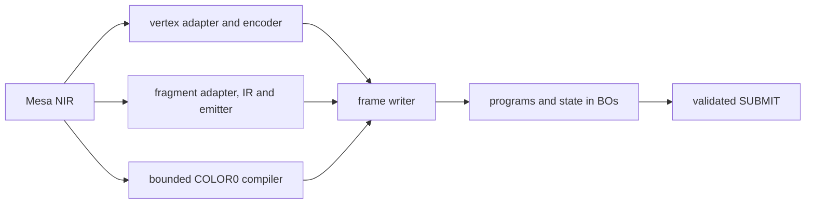

# SGX535 compiler and instruction codecs

The compiler turns Mesa NIR into SGX535 USSE words and constructs the PDS
programs that fetch attributes, load constants and dispatch those words. Mesa
owns shader objects and uploads; the kernel accepts BOs and validated register
tables, rather than shader IR. [Graphics](graphics.md#frame-path) owns that
integration and [native 3D](native-3d.md#task-images-and-launch-contracts) owns
packet/state construction.

There are two fragment implementations. GPU-shaded window draws use the
structured backend where both the shader and draw are accepted. CPU-shaded
draws, and GPU draws the backend leaves to the COLOR0 path, use the bounded
COLOR0 compiler. CPU vertex execution is Mesa's `draw` module;
fragments are never evaluated on the CPU for rendering.

## Program roles

| Program | Role |
| --- | --- |
| Vertex PDS | Fetch attributes by DMA and dispatch the vertex USE task. |
| Vertex USE | Execute vertex arithmetic, or pass through the CPU path's transformed attributes. |
| SECONDARY PDS / USE | DMA a draw's constants into SA; the accompanying USE program is `nop.end`. |
| Pixel PDS | Issue interpolated inputs and dispatch the fragment USE task. The backend also describes texture issues, integrated for the bounded 2D sampling path. |
| Fragment USE | Compute colour and, in the backend library, optional depth/discard and output epilogues. |
| Event PDS / USE | Finish tile/output work and supply PBE messages. Dispatch alone does not establish final resource use. |

A DWORD is 32 bits; F32 is IEEE binary32. Register indices, byte addresses and
encoded entry units remain distinct. [Hardware](hardware.md#use-banks-and-pds-addressing)
owns their shared address and task contracts.

## Components and data flow

The C-only libraries build without Mesa; NIR adapters build against the locked
Mesa tree. Builders validate their inputs and preserve outputs on failure as
specified by their headers. A CPU word test checks construction and numerical
models; it does not by itself establish physical execution, API conformance or
resource retirement. [Result scopes](architecture.md#result-scopes) apply to
every compiler family.

### Operations and numerical scope

| Path | Implemented construction | Current integration boundary |
| --- | --- | --- |
| Vertex backend | Float ALU, reciprocal/root/log/exp, comparisons, Boolean logic and selects; direct attributes and CB0 constants | GPU execution for accepted triangle draws; named refusals use Mesa CPU vertices where the remaining draw state permits it. |
| Fragment backend | Float ALU, comparisons/selects, derivatives, task-uniform branches/loops, texture operations, colour/depth/discard outputs and epilogues | GPU draws admit the backend's programs with the bounded samplers, varyings and output state in [Graphics](graphics.md#fragment-state-and-blits). Library features beyond those are not screen capabilities. |
| Bounded COLOR0 compiler | Bounded scalar SSA, COLOR0 or no-input programs, explicit clamp/PACK, raw sign and selected Boolean/comparison lowerings | Still used by CPU-shaded draws and compatible GPU draws. Each entry has its own grammar and bounds. |
| Instruction/PDS codecs | Typed fields, checked register/code spans and deterministic word emission | Codecs neither allocate resources nor submit GPU work. |

Some published screen capabilities name operations that still refuse at draw
time. [Screen admission](graphics.md#screen-admission) describes
the executable subset; [status pages](status/README.md) and the acceptance ledger
own API coverage. A finite rendered shader does not qualify all NaNs, signed
zeros, denormals, precision modes or instruction combinations.

## Vertex programs

`vertex_nir_adapter.c` and `vertex.c` consume a private clone of the state
tracker's NIR. IO becomes vec4 slots; ALU becomes scalar operations in one basic
block. The adapter accepts:

- float moves/vectors, add/multiply/MAD, source negate/absolute, min/max,
  saturation, reciprocal, reciprocal square root, square root, exp2/log2, pow,
  division, interpolation and dot products;
- float less-than/greater-or-equal and equality/inequality, Boolean-to-float,
  Boolean NOT/AND/OR and `bcsel`/`fcsel`;
- direct attributes, constant-offset CB0 loads and direct uniform loads.

Comparisons produce 0.0/1.0 through arithmetic steps, and selects become blends.
This is the implemented lowering, not a general IEEE special-value guarantee.
Constant-bound loops unroll and ifs whose sides are straight code become
selects; other control flow, indirect accesses and unsupported intrinsics refuse
with a named site. Outputs are kept by location, up to 16.

Each referenced uniform word or literal receives an SA slot, starting at sa1;
sa0 is reserved for the memory-constant base, which is not implemented. Per-layout linking supplies
missing attribute components as `(0,0,0,1)` and unpacks UNORM8 RGBA/BGRA with
`unpckf32u8.scale`. Single-use multiply/add pairs may become one MAD. POSITION
writes o0–o3; the link then writes the texture coordinates the fragment program
iterates, in its order and of the sizes it reads, up to ten 4-DWORD slots
(COLOR0 clamped to [0,1]). Last-use allocation allows
48 temporaries without spills. Limits are 384 IR instructions, eight elements,
four strides and 128 SA words.

The vertex PDS uses EMGD's DMA form: source addresses/descriptors and task
constants precede the code; index × stride is computed from the low 16 index
bits. SECONDARY PDS transfers the constant block in bounded lines and starts
`nop.end`. The task waits for the PDS DMA and ends with `emitvtx.end.freep`.
[The recovered vertex contract](re/emgd-linux/vertex-path.md) owns the legacy
field meanings; [GPU vertex shading](graphics.md#gpu-vertex-shading) owns draw
eligibility and BO lifetime.

The vertex encoder still emits its own words. Moving it to `use_encode.c` is
unfinished; the common fragment encoder must not be described as already shared
by both backends.

## Fragment backend

`fs_nir.c` lowers a private clone of st/mesa NIR to the scalar IR in
`sgx535_fs.h`; `fs_emit.c` emits through `use_encode.c`; `fs_epilogue.c` links an
output variant. The library and the window integration have different scopes.

### Library contracts

- **IR:** instructions define scalar values; source modifiers stay explicit.
  Per-pixel conditions become 1.0/0.0 values for selects and kills. Branches and
  loop conditions must be uniform per task; VAR loads/stores carry values
  across merges and loop iterations. Limits are 2,048 IR instructions, 1,024
  emitted instructions, 64 temporaries and 128 SA words including reserved sa0.
- **NIR lowering:** Mesa options lower division, pow, sqrt, interpolation and
  related operations. Sin/cos use the backend's half-angle polynomial.
  Per-pixel ifs are flattened into selects/kills; constant loops unroll. A
  remaining divergent branch refuses. Integer and Boolean arithmetic is lowered
  to float for the GLSL 1.20 range; this is not general integer arithmetic.
- **Emission:** last-use TEMP allocation, PA inputs and SA constants. A value
  used inside a loop lives through the loop's end. Comparisons use TEST and
  predicated moves. Texture reads issue `smp` and `wdf` before first use.
  Derivative/implicit-LOD programs avoid `.skipinv`. The result describes USE
  words, iterations, constants and the colour/depth/kill operands.
- **Constants:** uniforms, literals, texture words/sizes, orientation/facing and
  epilogue data carry distinct kinds. Integer uniforms convert to F32 at upload;
  any nonzero Boolean uniform becomes F32 1.0, zero becomes 0.0. Uniform units
  follow `packed_uniforms`; byte and DWORD offsets are never inferred from
  values. Constants 0.0/1.0 may use c48/c52.
- **Epilogues:** packed B8G8R8A8 colour, blending, colour masks, logic ops,
  alpha/discard and depth feedback use EMGD-form instructions. Visibility and
  colour can run in two phases; the pixel PDS names phase 2 through EXE1.
  The draw's alpha reference and ISP feedback words are SA data, rather than
  shader variants. The GPU draw integration links these variants within the
  restrictions below.
- **Sampling:** keys hold the stored result class, swizzle, shadow comparison
  and NPOT wrapping. U8/U88/U16/F32 and packed or multi-plane float results have
  explicit conversions. DOUTT words come from `sgx535_texture_words`; nearest
  NPOT REPEAT/MIRRORED_REPEAT can wrap in USE. The integrated resource path is
  narrower than this library: see [surface and sampler ownership](graphics.md#surface-and-sampler-ownership).

[The recovered fragment contract](re/emgd-linux/fragment-path.md) explains
iteration, ISP state, texture words and epilogues. EMGD word agreement is source
validation, and does not substitute for the corresponding poulsback GPU test.

### Window integration

`poulsback_fragment.c` connects the backend to GPU-shaded draws. Creation retains
the backend IR alongside the bounded COLOR0 program where that program is valid.
The draw compiles a body for its colour interpolation and sampled-result forms,
then links the output-state variant. Bodies and linked variants have bounded
per-program caches. Inputs may be smooth or flat; flat ones take the triangle's
last vertex, and `flatshade_first` refuses. The draw supplies uniforms, literals,
orientation/facing, texture and feedback constants. Derivative instructions
refuse this integration even though the compiler library can emit them.
COL0 uses the current vertex/PBE channel convention.

Each accepted backend draw supplies its own ISP groups, so depth comparison and
write mask, Z24S8 stencil, two-sided stencil and bounded polygon offset are
independent of the COLOR0 template. The writer adds the pixel PDS, SECONDARY
block and TA state task, reusing equal pixel state within the frame. See
[frame writer](graphics.md#frame-writer) for ownership and limits.

The GPU context also connects blend, colour-mask, logic/alpha/discard and depth
feedback variants, bounded 2D samplers, scissor and target-load objects. The exact
[draw and resource restrictions](graphics.md#fragment-state-and-blits) remain
part of admission: this is not the library's complete feature set or full API
qualification. A backend refusal can use the bounded COLOR0 program only if that
path accepts the complete draw state; unsupported state must not silently disappear.

## Bounded COLOR0 libraries

These APIs in `src/compiler` provide CPU construction and the fragment path used
by CPU-shaded draws and compatible GPU draws. Their C structures are internal
interfaces; the kernel receives BOs and register entries.

| Family | Contract |
| --- | --- |
| `usse`, `linear` | Direct bounded register operands and scalar SSA; 512 nodes, 124 TEMP words, no spills. |
| `fragment` | Input slots 0–9 with F32 prefixes, complete vec4 output and a 128-DWORD logical uniform space. |
| Raw sign | Explicit XOR/AND preserves sign-bit operations without substituting floating arithmetic; each entry retains its own floating-control gates. |
| Boolean/comparison adapters | Validate original NIR, lower on private clones and retain original source constraints; Boolean masks and raw payload selections remain distinct from float values. |
| Iterator/fragment PDS | Explicit ordered inputs, task dependencies and no-texture issue layout; a declaration does not authenticate a resource or grant submission. |
| Code-bank/PDS link | Full code extent inside a 512-KiB bank; code start and task entry share one 32-KiB block, with the entry 16-byte aligned. |

Validation precedes pruning: unsupported original operations, even dead ones,
are rejected where the API requires whole-source validation. Source/output
aliasing and allocation errors follow each header's transactional contract.

### Bounded fragment transport

`sgx535_fragment_instruction` is scalar SSA with sources referring to earlier
nodes, zero unused fields and four final OUTPUT nodes. Uniform metadata records
the referenced bitmap and highest logical word, separately from physical SA
population. `RAW_F32_WORDS` and `U8_WORD_PROJECTION` describe output structure;
the latter maps RGBA to packed byte lanes 2/1/0/3. Neither selects a PBE surface.

`sgx535_fragment_compile_dri_color0` requires smooth dense COLOR0 vec4 at slot
zero and maps it to PRIMARY 2/1/0/3. Generic-F32 entries use PRIMARY 0/1/2/3
while retaining the logical COLOR0 interface. The connected COLOR0 caller owns
semantic linkage and flat/smooth resolution.

### Finite normalized-color candidate

The normalized entries add explicit MAX(+0), MIN(+1) and scaled byte PACKs.
Their CPU reference uses binary32 clamp, multiplication by 255 and nearest-even
integer rounding. Raw-sign/raw-mask variants keep their own source grammar.
Numerical model tests do not close native rounding, nonfinite, interpolation or
PBE questions. These constructors also seed the frame writer's COLOR0 templates.
Their qualification fields describe library contracts; execution admission
belongs to the engine.

### Empty fragment input interface

The no-input constructor rejects every INPUT node, including dead ones, and
uses an empty iterator program with a position-only vertex producer. The
SECONDARY form maps logical uniform `i` to SA(`i+1`), reserving sa0. Header limits
and the caller's complete source/interface checks still apply.

### Uniform layouts

NIR adapters take explicit DWORD or vec4-slot units. Constant offsets are checked
for overflow and against the original declared uniform extent. Signed and
Boolean metadata must survive lowering until their matching upload converts
values. The bounded raw-SECONDARY path preserves words; it must not accidentally
apply the structured backend's float conversion policy.

## Verification

The C suites independently decode/evaluate emitted words and compare selected
PDS/epilogue vectors with recovered EMGD forms. The
[NIR fixture source](../tests/unit/test_fs_nir.cpp) compares backend word
evaluation with Mesa's own evaluation for shader inputs. The
[GPU frame fixture](../src/gallium/mesa/poulsback/test_frame_gpu.c) inspects words
reachable from submitted register tables, including state changes, constants
and the COLOR0/backend split. These sources require the matching Mesa
development dependencies; they are separate from the C-only suites.

[Tests](tests.md#graphics-apis) owns runnable checks and their scopes;
[Hardware](hardware.md#varyings-fragment-programs-and-depth) owns GPU contracts.
Host coverage of a library feature never raises an API capability.
