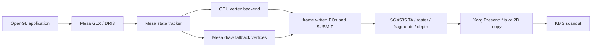

# Mesa and graphics integration

The Mesa overlay builds GLX/EGL/GBM/DRIL frontends, Gallium context/resource
callbacks and a DRM winsys. The published DRM screen renders through the kernel's
[execution engine](kernel/execution.md#p3-engine); unchanged glxgears, poulscube and glxheads
run on it in Xorg with the poulsback DDX ([Mesa status](status/mesa.md)).

The DDX (`src/xorg`) drives the panel through xf86Crtc/RandR 1.2 over the legacy
KMS ioctls: one CRTC per CRTC that can reach a connected output (on the Dell,
pipe B for LVDS; no request names a disabled pipe, see
[HW-DISP-001](hardware.md#display-pipes-and-scanout)), modes and EDID from the
connector, a fixed screen of the panel's size (a WC SCANOUT BO shown through a
typed framebuffer; the console's framebuffer is put back at exit), the
64×64 ARGB hardware cursor, the 256-entry gamma ramp and DPMS through the
connector's DPMS property (the LVDS encoder switches the panel; under the
typed front the pipe and its vblanks keep running; while off, no cursor or
gamma request reaches the pipe and Present uses its own clock; both are
restored at power-on). X draws under EXA in driver-pixmap mode
(`src/xorg/poulsback_exa.c`): X's own pixmaps of at least 4,096 pixels at
depth 24 or 32 are 2D-class WB BOs (smaller ones and other depths system
memory), client buffers and the front are BO pixmaps, and EXA's `PrepareAccess`
is X's only CPU wait for the GPU (a client buffer, or the front once a client
holds it, waits on its dma-buf every time; X's own BOs only while a 2D job of
X's names them, after submitting X's open job if it names them).
GL clients use DRI3 1.2 (XRGB8888 and ARGB8888, LINEAR
only; the server imports each client buffer by PRIME and keeps its CPU mapping,
and exports the front by PRIME) and
Present on the kernel's vblank events (`src/xorg/poulsback_present.c`: one DRM
vblank event per queued Present event, the 32-bit sequence extended to a 64-bit
MSC; a refused request leaves Present on its own clock). A fullscreen window
whose buffer is a SCANOUT BO in the front's size, pitch and XRGB8888 format is
page-flipped (its KMS framebuffer made at the first flip, completion from the
flip's DRM event), at any swap interval: the BASE store latches at a vblank, so
an async present is a flip that completes at the next one and never tears.
Other windows, and a covered one, are copied; an unflip flips back to the
front. The CPU draws unless that would read write-combined memory or wait for
the GPU: it writes the WC front at full speed but reads it slowly, and fills and
copies WB memory faster than the 2D core. So fills and copies on 2D-class BOs at
32 bpp (any GX function, a solid planemask; a planemask fill is a GXand and a
GXxor fill) are `SUBMIT_2D` operations on X's own context when the source is
WC, the function reads a WC destination, or an operand is a client's buffer or
named by an unfinished job of X's: Present's copies, copies out of the front,
scrolling. A copy within one pixmap is one surface, ordered by the kernel like
`memmove`. Operations gather in one job (one of 65,536 pixels or more runs
alone: within a job each command waits for the previous one's writes) until a
limit, a CPU access or destroyed pixmap it names, Present's flush, the screen's
BlockHandler or `FlushCallback`, so a client never learns of a copy before the
job reading its buffer is submitted; `dma_resv` orders it after the client's
render and before its next one, with no CPU wait. GetImage of a WC pixmap goes
through a WB staging pixmap the 2D core copies into, up to four times the rows
asked for, so that GetImage's 64 KiB strips come from one copy while the source
is unchanged (a per-pixmap generation that every write bumps). Stippled GXcopy
fills on WC memory are written by the CPU without reading the destination, and
points, thin lines and solid fills the policy leaves on the CPU go to fb directly
through GC operations above EXA's, without EXA's fallback work. A job the kernel
refuses is drawn by fb, and any other error turns 2D acceleration off for the
server's life. Everything else falls back to fb. Xorg's log counts the jobs,
operations, fb fallbacks of jobs, staged GetImages, stippled fills and CPU waits
at exit. Mesa places a window's back buffer in a write-combined SCANOUT BO only
when it is XRGB8888 in exactly the display's geometry (`DRM_IOCTL_PB_DISPLAY_INFO`),
so windowed clients keep write-back buffers that Present copies fast. Every
window-system image is a 2D-class BO, so the X server can copy it with the 2D
core in its own file ([HW-ADDR-005](hardware.md)); GENERAL-class client images can also import.

Current status: [Mesa / Gallium](status/mesa.md), [X11](status/x11.md),
[OpenGL 2.1](status/opengl-21.md) and [OpenGL ES 2.0](status/opengl-es-20.md).
The DDX path above does not qualify every X server feature: VT switching,
software cursor interaction with flips, DirectColor/console gamma restoration,
texture-from-pixmap and server regeneration still have open defects or coverage.
[Display](kernel/display.md) owns KMS limits and output qualification.

## Frame path

Vertex shaders execute on the USSE for accepted shaders/draws; the remaining
vertex work can use `draw_create_no_llvm`. MTE performs viewport, clipping and
culling in either path. Fragment/raster/depth work executes on the GPU.
The fragment backend supplies per-draw ISP state and linked output epilogues on
the GPU vertex path. CPU-shaded draws use the bounded COLOR0 fragment path.

The [kernel lifetime invariant](kernel/memory.md#memory-locking-and-lifetime)
governs shared resources. [Compiler](compiler.md#operations-and-numerical-scope)
owns shader semantics; [native 3D](native-3d.md#task-images-and-launch-contracts)
owns packet/state construction. Readback is a diagnostic oracle, rather than a
presentation mechanism. [Result scopes](architecture.md#result-scopes) distinguish
these implementation contracts from API qualification.

## Legacy OpenGL reference

EMGD's advertised API versions and limits belong to its selected source profile;
they are not poulsback capabilities or independently established silicon maxima.
[Source profiles](re/sources.md), [Hardware](hardware.md#windows-reference-profiles)
and the [legacy RE index](re/README.md) identify the Linux and Windows driver
interfaces used to derive hardware contracts.

## Locked sources and selected programs

`src/gallium/graphics.lock.json` pins Mesa, Xorg and mesa-demos inputs and the
selected source/shader identities. [Building](building.md#mesa) owns versions and
recipes. The overlay registers the ordinary DRM descriptor, pipe loader,
Gallium target and DRIL entrypoints. Poulsback integration must not enable
unrelated KMSRO targets or install unrelated DRI aliases.

Locked-source inspection and shader inventories are requirement lists. They do
not replace current frontend, loader, frame or conformance tests.

## Real glamor startup requirements

Glamor first attempts a desktop GL context of at least 2.1, then GLES2 if no
acceptable desktop context exists. Its startup shaders, gradients, FBOs,
blending, image import and required extensions must all work. A colour-copy
shader, a fabricated capability or glamor's own software fallback does not
qualify accelerated glamor. The current DDX uses EXA/fb; glamor remains open.

## Standard Mesa integration and fd ownership

The published `poulsback_drm_screen_create` accepts an identified poulsback DRM
FD and creates the resource domain, fence callbacks and ordinary pipe screen.
Contexts require the engine ABI and native fences. Screen creation is enabled;
the remaining screen/capability gaps are described under
[admission](#screen-admission).

The loader FD is borrowed. The image client reopens its `/proc` FD path into an
independent DRM file and checks exact device/driver identity. A duplicate would
share the caller's handle namespace and is insufficient. Resources and rendering
share the private namespace; no raw handle escapes it. Screen and context
lifetimes must outlive their resources, transfers and retained cleanup owners.
A failed final domain destroy keeps its owner rather than freeing live state.

The overlay also carries the project-authored NIR constant-array budget fix and
Mesa upload-manager allocation/map-failure fixes. These frontend fixes do not
expand native draw eligibility. Loader symbols, source restoration and isolated
packaging are covered by [Building](building.md#mesa) and [Tests](tests.md#graphics-apis).

## Owned image client

`poulsback_image.c` validates LINEAR XRGB8888/ARGB8888, zero offset, pitch divisible
by 128 and a page-rounded extent. Images use the 2D BO class; imports accept 2D
or GENERAL BOs. A display-sized XRGB8888 window-system image can use a WC SCANOUT
BO; other windows retain WB storage. Self-imports share one reference object and
close one GEM handle. Unsupported metadata/exporters refuse.

CPU access owns a temporary CLOEXEC dma-buf, mapping and BEGIN/END interval.
Failed END/unmap retains a cleanup record without repeating a successful END.
Failed final GEM close retains its reference. These bounded CPU cleanup retries
are not GPU recovery. The kernel's [BO/PRIME contract](kernel/memory.md#buffer-object-prime-and-cpu-access)
owns physical storage, reservations and publication.

## Gallium resource and imported-fence callbacks

Canonical colour resources are one-level, one-layer LINEAR B8G8R8A8/B8G8R8X8
images with FD import/export and CPU maps. Modifier allocation accepts LINEAR
only. `resource_get_param` supports plane/layer/level zero and returns stride,
offset, modifier, plane count or an owned FD; it does not export private DRM
handles as KMS handles. Unsupported resource/query/map shapes refuse.
Transfers retain resources and serialize active aliases. Uniform, vertex and
index storage uses the buffer domain below.

Depth resources carry canonical format, size and sample metadata. First native
use lazily allocates the same D24S8 layout for logical Z24X8 or Z24S8; jobs retain
their own native references. D16 metadata is capture-only. An attachment must
match its resource's level, layer, dimensions and effective sample count;
foreign or unsupported surfaces refuse before replacing references.

R8 `PIPE_BUFFER` operations support bounded upload, pattern clear and overlap-safe
copy. `clear_buffer` repeats an owned 1–16 byte pattern, including a partial tail;
`resource_copy_region` supports same-domain 1D byte ranges only. Active transfers,
foreign/image/depth resources and invalid spans refuse. These callbacks change
buffer bytes, rather than performing a texture copy or GPU image clear.

Imported fences duplicate and validate a sync-file FD and support reference,
export and timed wait. A readable FD alone is not successful completion. The
context's `create_fence_fd` borrows the input FD and returns an owned native-fence
reference. Server wait/signal and a general external `flush_resource` handoff
are not implemented.

### Buffer storage

`poulsback_slab.c` stores `PIPE_BUFFER` data in WB, GPU-snooped GENERAL BOs on the
resource domain's DRM file. A buffer up to 1 MiB gets a 256-byte-aligned span in
a 1 MiB slab; a larger one gets its own BO. New/reused storage is zeroed. At most
two empty slabs are retained. A suballocation returns only when its buffer is
destroyed and its last GPU reader has finished.

Jobs have one increasing sequence per winsys client. The open frame reserves its
sequence; GPU draws mark each buffer read with it. Reaping reports completion
before busy checks. The GPU currently reads these buffers, so CPU reads need
no GPU wait. CPU-vertex draws borrow mappings synchronously and mark no GPU use.

Writes to busy storage by subdata, discard maps, clear or copy destination rename
it and preserve bytes outside the write. The old span lives through its reader's
completion. `UNSYNCHRONIZED` range writes stay in place. Other synchronized write
maps flush/reap and wait up to 2 s; `DONTBLOCK` refuses. A write must not overwrite
bytes still reachable by a GPU job. `poulsback-slab` checks this on fake BOs.

## CPU vertex collection through Mesa draw

The retained fallback runs the vertex shader with Mesa's noLLVM draw module.
`poulsback_draw_stage_begin_clip_space` bypasses CPU clipping and viewport and
uses cull NONE; the final stage receives primitive-decomposed clip XYZW and linked
varyings. MTE applies the real viewport, clipping, W clamp and culling.
Positions may carry any finite W. There is no second CPU viewport transform or
window-position snapshot in this product path.

The collector buffers the bounded triangle list before a single sink call.
An invalid primitive cancels the batch; the sink must copy/write every referenced
byte before returning. Collection allocates its buffers at stage creation,
rather than per draw. Empty draws are no-ops before shader/resource use; indirect
requests and malformed or excessive lists refuse.

The fallback uses the bounded COLOR0 fragment/state restrictions: no sampled draw,
LESS with depth writes or no depth attachment, no stencil, blend or polygon
offset. If a GPU draw needs the new backend's state but its vertex shader/draw
cannot run on the GPU, the fallback refuses the complete draw. CPU vertex work
cannot silently discard unsupported raster state.

## Engine frames

Each context owns an engine context, a frame writer and three frame slots.
Each slot has a PDS BO and 1 MiB stream for vertices, client arrays, converted
indices and constants. Slot reuse waits for its last job's fence to signal
(bounded wait 2 s); this wait does not inspect the fence's error status. The first
draw takes the next slot; flush emits one
`SUBMIT` with the BO list, TA/raster register tables, colour/depth storage and
writer arenas. An absent depth attachment uses scratch depth with no-depth ISP
state. The kernel owns the scene buffer, DPM tables and parameter pool.

### Frame writer

`poulsback_frame.c` constructs commands without issuing ioctls:

- **Frame state:** size, clear colour and depth/no-depth select a persistent
  state. Ordered window-mesh builders create its background, mask/clear,
  terminate, event/PBE words and register templates once.
- **COLOR0 draw template:** checked fragment/uniform/interpolation/window state
  selects geometry/program sections in persistent arenas. The CPU vertex path
  writes its post-VS vertices once, 64 bytes of vertex PDS and a 28-byte TA entry.
- **GPU draw:** vertex code is placed once per program identity. Attribute DMA
  names VBO spans in place; client arrays and converted indices go through the
  stream. Each draw supplies vertex SECONDARY constants/PDS and an index list.
  Its base TA entry is 44 bytes, before any extra pixel state.
- **Backend pixel state:** the opaque variant's USE, pixel PDS, SECONDARY block
  and per-draw ISP groups are named by an additional TA state task. Uniform
  values are data, rather than COLOR0 template keys. The frame keeps the last
  four pixel states keyed by program, allocation, iterations, ISP words and
  constants; equal state reuses the earlier task. The memo resets at begin or
  discard.
- **Per frame:** header, ordered draw entries, trailer, event and target PBE
  fields. A smooth/backend colour draw selects the F32 family; COL0 iterates
  through TC0, preserving the current vertex/PBE channel order.

Up to four frame states and 256 COLOR0 draw groups per state are cached. PDS/code
arenas use bounded chunks; recycling waits for the GPU. A render takes at most
160 draws (GPU draws and frame objects), 32 additional vertex/index BOs and 512
program places; a draw beyond them is refused and the frame is not split. A
frame of clears alone renders with an object that writes nothing. The
CPU-vertex path retains its 4,096-vertex frame bound; GPU index values must fit
the supported index domain.
The writer's static u16 sequence contains 65,536 entries.

A full colour/depth clear restarts the open frame at depth 1.0; a clear depth
other than 1.0 is then written by a quad. A clear that does not start the frame
over (scissored, or of some buffers) is a quad after the frame's draws with its
own ISP words. A frame that no full clear began loads its colour and depth
([target path](#surface-and-sampler-ownership)). A depth attachment maps its
stored D24S8 planes for CPU reads (depth and stencil readback) once the open
frame is submitted and the jobs holding it are reaped.
Z24S8 stencil is initialized by a separate full-target ALWAYS/REPLACE object
before its first stencil draw, with any full-mask clear value. Without a stencil
clear, the previous clear value can be used only while no draw has written it.
[Native state construction](native-3d.md#current-draw-state) owns the ISP/MTE/PDS
word contracts.

`poulsback-frame-writer` compares COLOR0 template words after relocation;
`poulsback-frame-gpu` follows state, programs and constants from register tables
on fake BOs, including mixed GPU/CPU draws and memo reuse. These fixtures are CPU
checks. [Tests](tests.md#graphics-apis) owns how to run them.

### GPU vertex shading

`create_vs` reads NIR before Mesa draw consumes it, and keeps up to four encoded
variants per CSO for element layout and colour output. A refused shader names
its construct under `POULSBACK_TRACE`; `POULSBACK_VS=cpu` is a diagnostic A/B
selector. It is not the default path.

Accepted primitives are triangles, strips, fans, quads and polygons, converted
to triangle lists with GL's last provoking vertex. Primitive restart,
`flatshade_first` and two-sided lighting still refuse this GPU path. Elements
are F32 or UNORM8 RGBA/BGRA, up to eight, with DWORD-aligned offsets/strides
below 64 KiB. The PDS multiplies the low 16 index bits by stride, so each read
span is checked and indices stay below 65,536. U16/U32 index BOs can be read in
place; u8/client indices and converted primitives use the stream.

The draw marks every slab buffer read by the frame's reserved job sequence and
lists its BO. Constants from CB0/literals occupy SECONDARY words from sa1,
reserving sa0. Flat colour uses vertex 2 consistently in INDEXLIST, MTE and
DOUTI. [Vertex programs](compiler.md#vertex-programs) owns ALU and lowering limits.
[Hardware](hardware.md#varyings-fragment-programs-and-depth) owns vertex,
requester and clipping contracts; [Tests](tests.md#graphics-apis) owns fixture
selection and its scope.

### Fragment state and blits

For GPU-shaded draws accepted by `poulsback_fragment.c`, the structured backend
connects per-draw depth functions/write masks, Z24S8 stencil and two-sided stencil,
culling and integer polygon offset factor/units −16…15 without clamp. Linked
output variants supply blending, colour masks, logic operations, alpha tests,
discard and depth feedback within the [compiler's limits](compiler.md#fragment-backend).
Dual-source and advanced blending, independent blend targets and multisampling
refuse. A two-phase visibility test requires equal front/back stencil references,
value masks and write masks. Derivative instructions still refuse integration.

Varyings may be smooth or flat; flat ones take the triangle's last vertex, and
`flatshade_first` refuses. Sampling uses the bounded resources described below. Scissor
changes emit draw-mask objects before the affected draw. Backend draws also
accept a positive-Y FBO viewport and nondefault depth range; CPU-shaded or
COLOR0-program draws retain the narrower window viewport and LESS/write or
no-depth profile. Unsupported backend-only state cannot fall back to that
narrower path. These are source integration contracts, separate from the named
[device checks](status/3d.md#working-and-checked).

`pipe->blit` handles Mesa DRI3 buffer preservation: an unscaled whole-pixel copy
between matching colour formats (or within one image), inside both images, with
no scissor, swizzle, window rectangles or blending. It flushes queued draws and
issues `SUBMIT_2D`, ordered by the context and `dma_resv`, without a CPU copy.
A different blit or a kernel-refused copy stops the context; `util_blitter` and
general FBO blits are not implemented.

## Surface and sampler ownership

Sampler objects own copied descriptors; views retain resources and creator
contexts. Deleted objects remain alive while bound, within a total of 4,096
states/views per context. Framebuffer surface replacement validates the canonical
resource before changing references.

GPU backend draws resolve only the sampler units their shader reads. The current
resource path accepts single-level 2D B8G8R8A8/B8G8R8X8 images, with a stride
matching rows padded to 32 texels, normalized coordinates and component swizzles.
CLAMP_TO_EDGE accepts nearest or linear filtering. GL_CLAMP, REPEAT and
MIRRORED_REPEAT accept nearest filtering; repeats wrap coordinates in USE before
a dependent read. Shadow comparison, border wrapping, anisotropy above one,
mip levels, array layers, cube/3D textures and other sampled formats refuse.
The open frame retains each sampled image and its resource until submission.
The broader [texture library](native-3d.md#texture-memory) has a larger host-only
format/layout scope than these callbacks.

The target path uses one single-sample colour attachment and optional matching
Z24X8/Z24S8 storage. Changing the framebuffer flushes the open frame. When a full
clear does not begin a frame, a GPU load draw samples the previous colour target;
the frame's depth/stencil load state preserves its attachment. Positive-Y FBO
viewports and scissored clear objects are wired in the source. General attachment,
format, feedback, sampling and render-to-texture correctness still require their
complete device selection; these hooks alone do not qualify FBO support.

## Screen admission

The published DRM screen runs unchanged glxgears, glxheads and poulscube through
GLX/DRI3/Present. It uses GPU vertices where accepted, retains CPU vertex fallback,
and executes fragments/raster/depth on the SGX. The backend also connects the
bounded state, sampler and target paths described above. This source integration
and the named device checks do not establish complete GL 2.1 or GLES2.

Current colour formats are B8G8R8A8/B8G8R8X8 with logical Z24X8/Z24S8, one sample.
The screen still advertises some capabilities whose complete operation matrix
refuses. Truthful caps, the complete texture/FBO and fragment-state selections,
points/lines and broader shader/interface coverage remain open. See
[compiler scope](compiler.md#operations-and-numerical-scope) and the
[status/acceptance model](status/README.md) before interpreting an API string.

A GPU loss wedges the engine for the boot. Mesa learns loss at engine ioctls and
reports unknown reset through robust-context callbacks; robust buffer access
remains refused. Fence signalling does not prove GPU retirement or recovery;
the kernel retains every resource the uncertain GPU could still reach. The DDX
can keep an unaccelerated desktop after device loss under its documented limits.

## Research profiles

Wayland and OpenGL 3.0 are separate feasibility work. The current X11 path and
host compiler features do not establish either profile.

### Wayland desktop

No Wayland integration is qualified. The intended route uses the same Gallium
screen, EGL/GBM, dma-buf resources and KMS device. Desktop composition requires
working textures, blending, render targets and import/synchronization; native
2D completion alone is not a prerequisite or sufficient result.

Qualification requires a pinned compositor/client/protocol set, its actual
EGL/GL extensions and shaders, Mesa's Wayland platform, supported shared-image
layouts and cross-client synchronization. GPU completion, texture visibility,
compositor buffer release and display release remain separate. Choose a
compositor that fits the implemented API rather than raising versions or forcing
extensions. [Wayland checks](tests.md#wayland-research) and
[status](status/wayland.md) own that scope.

### OpenGL 3.0

Theoretical feasibility must map each normative requirement to an SGX535
contract, Mesa lowering, resource/precision limit, implementation gap and
independent test. GLSL 1.30/integer operations, additional texture formats and
arrays, transform feedback, multisampling, queries and advertised limits need
explicit assessment. A finite shader or scene does not establish this coverage.

[Research checks](tests.md#opengl-30-research) must precede a version claim.
OpenGL 3.0 is not part of the current DoD merely because a research profile is
listed here; [status](status/opengl-3.md) tracks the investigation.
