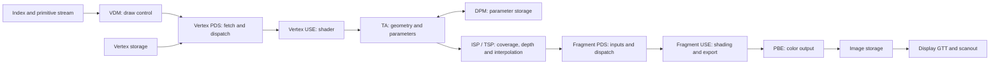

# GPU hardware reference

This reference describes SGX535 rendering, display translation and MSVDX
contracts used by the current driver. The
[hardware inventory](../README.md#hardware-behind-the-project) lists the project
machines. Device observations here apply to the Dell reference unless stated
otherwise; GMA 600 qualification is separate.

A source contract comes from a matched producer and consumer. A device
observation establishes behavior for its tested inputs. Host validation checks
our implementation; full API qualification has its own selection. The
[status pages](status/README.md) own current capabilities, and component guides
own software interfaces. This reference keeps current facts rather than run journals.

## Frame data flow

Each connection needs a matching layout, address domain, visibility and
completion contract. Rendering to a BO and presenting it are separate actions;
[Graphics](graphics.md#frame-path) describes the current frame path.

## Engines and reference profiles

The Dell has PCI device `8086:8108`, subsystem `1028:02b1`, revision 06, with
SGX core `0x01130000` and revision register `0x00010201`. PCI and SGX revision
identifiers are different fields.

The primary vendor reference is Linux EMGD 1.8 Build 2032. The PSB source,
PSB runtime and Windows branches have separate identities in the
[RE source guide](re/sources.md). Matching register names do not make their
firmware, command packets or memory policies interchangeable.

### Windows reference profiles

| Reference | Display INF/PE version | Relevant PCI IDs |
| --- | --- | --- |
| Retail ultra-mobile driver, package `5.0.0.2030` | `8.14.10.2030` | `8086:8108`, `8086:8109` |
| Embedded EMGD, build `1.18_RC_3398` | `8.14.1180.3398` | `8086:8108`, `8086:4108` |

These are selected implementation sources. Source versions and package
contents do not declare poulsback support on another machine.

### Source selection

Start with Linux EMGD matched to the Dell, then the applicable Windows EMGD
implementation, then PSB. Choose the source that contains the relevant
producer and consumer. The [RE index](re/README.md),
[source identities](re/sources.md) and [address domains](re/address-domains.md)
explain the mechanisms and locators.

Other drivers serve as comparisons only. Static agreement and captured
behavior have separate scopes.

## Memory and address domains

### HW-ADDR-001 — display and SGX translation

Display PGETBL is at BAR0 + `0x2020`; SGX directory selection is at
BAR0 + `0x40000` + `0xc84`. Display GTT has one 32-bit PTE per 4096-byte
aperture page. These are independent translation systems.

### HW-ADDR-002 — SGX pages and typed VA windows

SGX VAs are byte addresses. Physical PFNs index 4096-byte pages; each page
directory has 1024 PDEs, each page table 1024 PTEs, covering 4 MiB per PDE.
Depth storage uses the driver policy window `0x50000000`–`0x5fffffff` and
cannot cross a 256-MiB boundary because of the ZLS high-4/low-28 split.
A valid PTE does not establish requester routing or read-only protection.
[Memory](kernel/memory.md) owns BO allocation and mapping policy.

### HW-DPM-001 — device-owned storage

The engine reserves two 32-MiB areas, each 8192 pages: the parameter buffer
and DPM tables. These sizes are allocation policy, not silicon maxima.
LOAD/INIT events do not by themselves establish a full DMA write extent.

### HW-DPM-002 — the two DPM contexts

`STATE_CONTEXT_ID` (`0x630`) selects ALLOC and LS for a TA. DALLOC selects
that context before raster, which frees its pages. Alternating the two
contexts does not require state store/load when each scene retains its own
context and region headers. A TA may run in one context while another job's
raster frees the other, in the same directory and the other region-header
array: tens of thousands of such TA passes ran with frames unchanged, no fault
and no out-of-memory.

### HW-CACHE-002 — WB coherence on the 2D core

With snooped PTEs, the 2D core reads CPU-written WB source data and writes WB
destinations without explicit cache maintenance. The checked cases include
CPU-dirty and evicted source/destination cache lines. This contract covers
the 2D core; other GPU requesters need their own visibility rules.

### HW-CACHE-003 — WB vertex and index reads

PDS DMA and index fetch read CPU-written WB BOs through snooped PTEs. Checked
VBO/IBO application images match the CPU vertex path. This establishes the
selected reads, not GPU writes into those buffers or a universal coherency
contract for every requester.

### HW-ADDR-003 — directory routing and invalidation

`BIF_BANK0` routes requesters to directory slots. The 3D route selects pixel
writes, pixel USE fetches and pixel PDS fetches. A remapped PTE needs
`INVALDC` before reuse. Routing, code fetch and data visibility remain
separate checks.

### HW-ADDR-004 — 2D requesters

The 2D core writes through `BANK0.TA` and reads through `BANK0.2D`. Both
must name the job's directory for a copy. Its address window starts at
`TWOD_REQ_BASE` (`0xd0000000`) and spans 256 MiB. A 2D job and TA therefore
cannot use different directories at the same time.

### HW-ADDR-005 — render-to-copy handoff

The pixel back end can write a target in the 2D VA class using WB pages with
snooped PTEs or WC SCANOUT pages with non-snooped PTEs. A 2D job in another
file can then copy the frame, ordered by the target's `dma_resv` and the
executor's directory-cache invalidation. The current windowed Present path
uses this handoff.

### HW-ADDR-006 — 2D work during raster

A 2D copy in another file's directory may overlap a raster pass using the
3D directory. The driver serializes 2D with TA, and keeps directory slots
and scene owners pinned during their use. The absence of a fault in a
raster-only operation does not establish an immediate TA rerouting boundary.

### HW-ADDR-007 — late TA-requester access

A TA-requester access can follow the observed TA-finished/TPC-flush event
boundary during TA/raster overlap. A completion event alone is therefore
insufficient evidence to reroute TA to a directory without its scene pages.
The engine keeps `BANK0.TA` at the 3D job's slot while a 3D job holds the
directory, so a late access lands in the scene it belongs to; a 2D job moves
it later, from its work item.

### HW-2D-001 — rectangle sizes

Selected fill/copy fixtures cover all 16 GX logical operations in ARGB8888,
XRGB8888 and RGB565, including WC/WB storage combinations, against independent
per-bit models. The broader dimension/edge matrix covers GXcopy and GXxor
and has no width-eight or height-eight erratum. Clipped rectangles of that
size use the ordinary encoding. Format, stride, bounds and overlap rules
still apply; complete combined parameter acceptance is separate.

### HW-2D-002 — signed stride

The 15-bit surface stride is a signed byte count. The encoder accepts
positive strides up to 16,383 bytes, or 16,256 in 128-byte steps; this limits
a 32-bit surface to 4064 pixels per row. Negative strides are not offered.

### HW-2D-003 — per-command ordering

Each command uses its own FENCE and FLUSH. Removing intermediate barriers
can corrupt dependent copies or hang long jobs. The supported encoder keeps
the complete per-command sequence.

### HW-2D-004 — the scratch tail

The 2D core can touch the last page a job wrote when the next job starts,
through the new job's TA routing. Each nonempty job therefore ends with a
1×1 fill of a scratch page mapped in every file at `TWOD_REQ_BASE`.
The allocatable 2D class starts one page above it. Whether this extra touch
writes data or only translates is unresolved.

### HW-2D-005 — shared throughput

Concurrent 2D copies and 3D raster can slow one another. Overlap improves
frame throughput only when their shared-resource cost permits it; neither
engine's isolated rate predicts the combined rate.

### HW-2D-006 — destination alignment

A destination starting off a 64-byte boundary is slower for fills and copies.
The planner splits sufficiently large rectangles into a short head and an
aligned body, preserving overlap order. Its size threshold is driver policy;
[Native 2D](native-2d.md) owns the encoding and planner limits.

## Startup, execution and completion

### HW-BOOT-001 — engine identity

Bring-up requires the matched PCI/core/revision identity. The selected
SGX535 profile uses disabled DMS value `0x0518820f` under mask `0x0fffffff`.
Register quietness or reset release alone does not establish engine readiness.
[Execution](kernel/execution.md#p3-engine) owns the complete bring-up sequence.

### HW-BOOT-002 — ISP reset

The ISP reset pair is register `0x80 = 0x20`, then `0`, as one non-sleeping
transaction. It is distinct from startup/global reset and does not authorize
runtime recovery or arbitrary reset sequences.

### HW-BOOT-003 — source-specific reset addresses

The Windows retail temporary-reset path has a source-specific address
interpretation that is unresolved. It is not substituted into the current
engine's bring-up. [Windows bootstrap](re/windows/retail-bootstrap-and-retirement.md)
owns that producer/consumer boundary.

### HW-BOOT-004 — reset field roles

Matched reset sources distinguish hardware fields and completion conditions.
A shared register offset does not make two reset profiles interchangeable.
The current driver loses an engine with unknown outcome and retains its
resources; recovery is unimplemented.

### HW-IRQ-001 — status domains

EVENT1/ACK1 are `0x12c`/`0x134`, STATUS2/ACK2 `0x118`/`0x114`, and PDS cache
status/ack `0x138`/`0x140`. Equal bit numbers in different domains represent
different events. Stale status or the master interrupt bit alone gives no
fresh completion credit.

### HW-IRQ-003 — Dell idle-state timing

The Dell lacks ARAT; deep idle states rely on HPET broadcast, and the TSC
halts below C2. The machine can stall for a 32-bit HPET wrap, about 300 s,
with deep idle enabled. The engine uses a CPU latency request while active.
A missed broadcast is an inference, and the issue also affects idle operation;
it is not established as an SGX hardware defect.

### HW-COMP-001 — event and cache fields

EVENT1 masks include TA_DONE `0x2000`, PB_END `0x40000` and FREE `1`.
The BIF invalidation pulse is `8 → 0 → readback`. `BLIT_STATUS` busy covers
2D, not global 3D idle; `0xca8 & 0xff` counts READS, not drained writes.
An invalidate pulse is not an independently acknowledged write flush.

### HW-COMP-002 — 2D completion

`BLIT_STATUS` (`0xe04`) bits 23:0 count the encoder's FENCE/FLUSH words,
advancing by two per operation; bit 24 is busy. EVENT_STATUS bit 27 can
coalesce, so interrupt count is not command count. `SOCIF` (`0xe18`) low
8 bits give free slave-port slots and read `0x80` when empty.

### HW-RET-001 — resource last use

Matched PSB source retires resources from their recorded uses, references,
cache and translation transitions. Completion, withdrawal and session
destruction are separate contracts. [Memory](kernel/memory.md) and
[Display](kernel/display.md) own current BO/fence and Present lifetime rules.

### HW-RET-002 — Windows cleanup acknowledgement

The Windows cleanup mailbox is a shared acknowledgement. Its host wait and
counter alone do not establish a matching final GPU write or safe page reuse.
[Windows retirement](re/windows/retail-bootstrap-and-retirement.md) explains
the source-specific chain.

## USE banks and PDS addressing

### HW-LINK-001 — code-bank units

USE CODE bank register `0xa0c + 4*i` encodes a base in 128-byte units:
`(base_va >> 7) | (DM << 25)`. A bank covers 512 KiB, and USE instructions
are 8 bytes. The compiler admits vertex DM 0 and pixel DM 1. Address
projection does not reserve a bank or establish upload visibility.

### HW-LINK-002 — engine bank policy

The engine programs six 512-KiB vertex/pixel windows: bank `3 + 2*w` for
vertex and `4 + 2*w` for pixel, `w = 0..5`, starting at `0x40000000`.
These assignments are driver policy.

### HW-LINK-003 — task entries

The matched PDS task entry is bank-relative in 16-byte units. Bank selector
uses bits `0..3`, high entry bits `4..7` and low entry bits `8..18`.
The constructor requires code start and entry in one 32-KiB block. This
constructor restriction is not an architectural shader-size limit.

### HW-LINK-004 — Windows registration

The retail Windows initializer projects descriptor types into distinct USE
bank ranges and DM values. Its DM3 producer is a separate source contract;
it does not enable DM3 in the current compiler or prove exclusive ownership.
The [source profile](re/sources.md#windows-retail-2030) selects that implementation.

### HW-PDS-001 — PDS pointer units

`PDS_EXEC_BASE` (`0xab8`) uses GPU byte base `0x20000000`. MTE shader
pointers use `(va >> 4) & 0xffffff`; TA packet pointers use
`(va >> 4) & 0xfffffff`; register `0x238` takes a full byte VA.
Event PDS register `0xa5c` takes a byte VA with low four bits cleared.
Units and owner extents are checked for each field independently.

### HW-PDS-002 — vertex DMA

Vertex DMA descriptors use DWORD counts and byte offsets. The bounded
constructor's eight-DWORD input uses descriptor `0x80e00007` and 32-byte
stride; its 1–256-DWORD bound is constructor policy. A valid descriptor does
not establish completion.

### HW-PDS-003 — position and color transport

The position/COLOR0 pass-through recipe copies eight 32-bit words without an
explicit color PACK. This does not exclude implicit MTE/ISP conversion.
Source extent, relocated entries and task controls must match the producer.

### HW-PDS-004 — COLOR0 iteration

COLOR0 issue `0x0fd0a00f` requests four perspective/Gouraud scalars in the
matched F32 producer. Bit 20 means non-U8 there; it is not a unique F32 flag
or a PACK rounding selector. Internal interpolation precision remains open.

### HW-PDS-005 — state allocation

Linux EMGD encodes primary allocation as `ceil(bytes / 16)` in the low eight
bits of the TA state word. PDS data size, allocation, meaningful record
length and emitted output count are separate quantities. The current
constructors must satisfy their matching DMA/USE task extents.

## Varyings, fragment programs and depth

### HW-SHADER-011 — vertex execution

The accepted USE vertex path uses direct PA, SA, temporary and output operands,
including the F32 operations and element conversions documented in
[Compiler](compiler.md#vertex-programs). Vertex PDS supplies DMA and per-draw
SECONDARY constants. Application/fixture image comparisons cover the selected
programs; they do not establish a universal floating-point precision model.

### HW-SHADER-012 — fragments and window state

The integrated fragment backend provides GPU-vertex draws with per-draw
ISP state: eight depth functions, depth write masks, Z24S8 stencil and
two-sided stencil, and bounded integer polygon offset. A stencil clear is its
own object; equal pixel states share their task within a frame. These paths
have selected device fixtures. The source additionally wires bounded blend,
sampler and target paths; those connections do not extend this claim's recorded
device scope. [Graphics](graphics.md#fragment-state-and-blits) owns their exact
admission limits; complete qualification remains open in [3D status](status/3d.md).

### HW-SHADER-013 — vertex task instances

A vertex task declares its max input instances (INDEXLIST w2 31:28, minus
one). With fewer instances than its output partition holds vertices (w4
PARTSIZE + 1), simple draws render, but two failures follow: beside a raster,
pixel tasks' attributes are overrun (the pixel back end writes through garbage
addresses), and an index list naming one vertex leaves the TA pass unfinished
with no fault. The driver declares the maximum input instances as the
attribute space left over three, at most 16, and never below the partition
there.

### HW-RASTER-002 — vendor target state

The Windows single-sample target policy selects `0x418=1`, `0x4c8=0x88`,
`0x800=1` for its flagged target and `0/0/0` otherwise. This tuple is a
source-specific policy, not a Gallium flag or a complete edge equation.
[Raster conventions](re/sgx535/raster-conventions.md) owns the API distinction.

### HW-RASTER-003 — clipping and culling

The current path supplies clip-space input, viewport and culling state.
Selected comparisons with llvmpipe check culling and clipping while retaining
edge/smooth-color precision differences. The independent numerical effect of
WCLAMPEN and general subpixel behavior remain unresolved.

### HW-VIEWPORT-001 — depth viewport

The matched PSB and Windows OpenGL producers give
`Sz=(far-near)/2`, `Tz=(near+far)/2`, hence `.5/.5` for the default depth
range. Their CPU clip path tests Z against ±W. These source formulas do not
define universal binary rounding or D24 quantization; [depth contracts](re/sgx535/depth-contract.md)
separate viewport transport, comparison, storage and conversion.

## Firmware, display timing and power

### VBIOS and panel data

**HW-FW-001:** Raw VBT, runtime VBT and cached connector EDID are distinct
inputs. POST can modify panel metadata. Use the selected KMS mode.

**HW-FW-004:** The selected Dell A02/A04 VBIOS ROM is 65,536 bytes with
SHA-256 `dad81a9f026ba502cd65388932262c0d011b9b6758fa1077cf1052dd2e3b4c19`;
its BDB version is 131. Matching OEM ROM code is one lineage, not independent
corroboration of behavior.

**HW-FW-005:** Panel 13's BDB 42 timing and BDB 46 template differ. The raw
BDB 42 gives 68,900 kHz, totals 1440×823 (58.1376 Hz); the BDB 46 template
gives 70,100 kHz, totals 1419×823 (60.0255 Hz). Neither calculated refresh
nor cached EDID alone measures the active pipe.
[BIOS/display/power](re/platform/bios-display-power.md) owns the source chain.

### Display GTT and stolen memory

**HW-FW-006:** The VBIOS derives stolen memory, aperture and GTT placement
from PCI configuration. For stolen base `B`, stolen bytes `S` and aperture
size `A` in MiB, its table size is `A * 1024` bytes and table base
`G = B + S - table_bytes`. It programs `PGETBL_CTL = G | 1` and reserves
`G - B - 4096` usable stolen bytes. Runtime Linux can replace the PTEs;
this firmware formula is not a new allocation recipe.

### Display pipes and scanout

**HW-DISP-001:** The Dell LVDS panel uses pipe B; pipe A is disabled.
Reading its disabled frame-counter/plane registers can hang the machine.
The driver reads only `PIPECONF` on a disabled pipe. Other registers there
remain unqualified and must not be probed.

**HW-DISP-002:** A 1280×800 SCANOUT BO has 4,096,000 WC bytes, 1000 display
GTT pages and pitch 5120. Its `DSPBASE` is a 256-KiB-aligned aperture offset;
image PTEs are physical page address `| 9`. SGX addresses and display GTT
offsets remain distinct. GPU writes to this storage use HW-ADDR-005.

**HW-DISP-003:** Pipe B vblank interrupts use the gma500 handler, independent
of SGX jobs. The kernel timestamps IRQ delivery rather than a hardware time
counter, so individual intervals jitter. Cursor position is sign-magnitude;
the 64×64 ARGB cursor and gamma palette use their display-plane interfaces.

**HW-DISP-004:** For the Dell mode, totals are 1419×823 and one line is about
20.29 µs. `PIPEBFRAMEPIXEL` wraps at the start of active line 0, not at
vblank. The scanline register is offset from that counter. DRM's vblank
count therefore needs the hardware-specific boundary adjustment.

**HW-DISP-005:** `DSPBASE` latches at vblank. A store before the boundary
selects the next frame; one after selects the frame after it. The flip event
must follow the store and the applicable vblank, so the replaced buffer is
retired only after its final scanout. The Dell's flip/IdleNotify path has
visual and buffer-reuse checks; it has no pipe CRC oracle.
[Display](kernel/display.md) owns the implementation and supported modes.

### Clocks, ACPI and firmware integrity

**HW-FW-002:** VBIOS and Linux clock decoders disagree for selectors 6/7:
200 MHz versus 266 MHz. Selectors 0–5 agree. Record the active selector and
decoder before interpreting a frequency. Message-bus reads program a selector;
they are not passive memory reads and authorize no frequency override.
[Captured render state](re/platform/runtime-render-state.md) explains the
separate runtime clock and gating contracts.

**HW-FW-003 / HW-FW-007:** ACPI battery/AC fields carry units and runtime
relocation. Static AML placeholders are not addresses to dereference.
AC reports, CPU temperature and battery power are not SGX clock, temperature
or watt counters. Firmware extraction must check declared extent and checksums;
a successful extractor exit is insufficient.

### GMA 600 reference: Fujitsu Q550/C

Read-only observations with Debian's stock `gma500_gfx` on `6.1.0-54-686-pae`.
Poulsback has not run on this machine, and no SGX or display register was read
beyond what that stock driver does. None of the Dell contracts above transfer.

**HW-GMA600-001:** The Q550/C (DMI `FMVNQ4LE`, board `FJNB230`, Phoenix BIOS
1.25) is an Oaktrail platform: Atom Z670 (family 6, model 38, two threads,
PAE and NX), 2 GiB RAM, host bridge `8086:4110`. The GPU is PCI
`8086:4102`, subsystem `10cf:16b5`, revision 04, with a 1 MiB MMIO BAR, a
256 MiB aperture BAR, a 256 KiB BAR and MSI. HDMI is the separate function
`8086:080d` (01:01.0), which no driver binds. EMGD 1.18 lists `0x4102` only
under `#if 0`. gma500 places the SGX at MMIO BAR offset `0x80000` on this
family (`MRST_SGX_OFFSET`; `0x40000` on Poulsbo). The SGX core ID, revision and
clock are unread, and no local source gives them for this part.

**HW-GMA600-002:** The firmware is 32-bit UEFI. Linux hangs in the EFI runtime
virtual-address switch unless booted with `efi=noruntime`. With that option,
EFI variables are unavailable and GRUB boots through the removable path
`EFI/BOOT/BOOTIA32.EFI`.

**HW-GMA600-003:** Stock gma500 lights the LVDS panel at 1280×800 (fbcon
`gma500drmfb`, 32 bpp, pitch 5120). Its GCT read fails: the uncached `ioremap`
of `0x7f579000` (the address in the GPU's own config space at `0xFC`, inside
ACPI NVS) conflicts with an existing write-back mapping. No GCT panel timing
or dither flag is used. The LVDS DDC read returns no EDID (gma500's
`No ddc adapter available!` line is the LVDS one). The panel mode therefore
comes from the VBT that gma500 parses when the GCT is missing.

**HW-GMA600-004:** Stock HDMI (`DVI-D-1`) has no DDC bus. gma500 adds its HDMI
I2C adapter with the fixed number 3, which its own GMBUS adapters already hold
(`i2c-3`, "gmbus vga"). The add fails with a kernel WARN (taint W), and the
connector reports disconnected.

**HW-GMA600-005:** There is no backlight interface. gma500 skips `oaktrail-bl`
registration, ACPI video registers none, and `fujitsu_laptop` registers none
for `FUJ02B1`, although `\_SB.PCI0.GFX0` has
`_BCL`/`_BCM` (DSDT) and `_BQC` (SSDT `VistSsdt`). The cause is not
established. The DSDT's newest `_OSI` string is `Windows 2009`.

**HW-GMA600-006:** System sleep is unsafe under stock gma500. Its Oaktrail
power-island code (`oaktrail_power_down`/`_up`) does port I/O at
`ospm_base + 0x20` and `+ 0x30`, but nothing sets `ospm_base` on this family
(only Cedarview does). The accesses therefore land on ports `0x20`/`0x30`, in
the legacy interrupt controller's range. gma500 holds a runtime-PM reference,
so only suspend and hibernate reach this code. Neither has been tried.

## MSVDX boundary

MSVDX has separate MTX firmware, messages, translation and YUV surface lifetimes.
An SGX completion cannot certify video completion. Firmware upload and command
encoding do not establish decoded output or retirement.
[Video](video.md) owns the current CPU libraries and open hardware/API work;
[decode RE](re/video/decode-pipeline.md) owns the vendor mechanisms.

## Unresolved hardware contracts

- General interpolation/conversion precision, subpixel coverage and D24
  quantization remain open despite selected working rendering fixtures.
- Complete engine/display teardown, unload/reload and suspend/resume are
  unfinished. Unknown GPU outcomes retain their reachable resources.
- Broader compositor, VT and output qualification remains open; see
  [X11 status](status/x11.md).
- Current-driver decode, executing firmware identity, matched replies,
  reference lifetime and final writes remain open for video.

## Maintaining this reference

Keep units, prerequisites, source identity and qualification limits with each
contract. The [RE reference](re/README.md) owns derivations, component guides
own interfaces, and [status](status/README.md) owns current abilities.
Keep dated progress, experiment narratives and superseded implementations out
of this reference.
