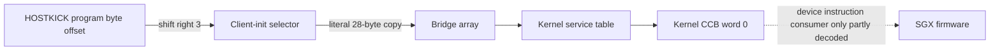

# Linux EMGD bootstrap and memory

The selected Linux EMGD 1.8 Build 2032 initializer converts firmware entry
offsets into Services command selectors. That conversion is separate from USE
code-bank setup, context registration and memory mapping. Component hashes and
the matching package are listed in [Sources](../sources.md). Addresses in this
chapter belong to that version, not to the later EMGD 1.18 packages.

## Service selectors have their own units

`SGXInit` starts at ELF VA `0x16b0`, analysis address `0x116b0` in the selected
import. It reads the exported `ui32uKernelProgramOffsetHOSTKICK*` values through
resolved GOT relocations, shifts each right by three, and writes seven words
starting at byte offset `0x8c` in the client-init structure. These assignments
do not add a heap base.

| Service kind | Program byte offset | Encoded word | Shift / store ELF VA |
| --- | ---: | ---: | --- |
| TA 0 | `0x12a0` | `0x254` | `0x1c11 / 0x1c14` |
| TRANSFER 1 | `0x11d0` | `0x23a` | `0x1c22 / 0x1c25` |
| 2D 2 | `0x10f8` | `0x21f` | `0x1c33 / 0x1c36` |
| POWER 3 | `0x1038` | `0x207` | `0x1c44 / 0x1c47` |
| CLEANUP 4 | `0x1388` | `0x271` | `0x1c55 / 0x1c58` |
| GETMISCINFO 5 | `0x1520` | `0x2a4` | `0x1c66 / 0x1c69` |
| PROCESS_QUEUES 6 | `0x1470` | `0x28e` | `0x1c77 / 0x1c7a` |

The userspace `SGXDevInitPart2` consumer copies all 28 bytes unchanged at ELF
`0x7751–0x7769`, into byte offset `0x20` of its full bridge input. The input has
an eight-byte prefix, so the array is at `+0x18` relative to the embedded
`SGX_BRIDGE_INIT_INFO`. Matching `sgxinit.c:184–185` copies it into device info.
The scheduler then selects one word for a four-DWORD kernel CCB slot.



The [publication contract](submission-packet.md) explains how a selected service
word reaches a kernel slot. Selector construction does not decode the firmware
instructions it names. ELF interposition can change resolved exported globals,
so carrier defaults and live bindings are separate identities.

## Code banks use a different address field

The initializer selects heap descriptor ID 2, called the kernel code heap in
the matching headers, and reads its device virtual byte base `B`. At ELF
`0x2883–0x28a6` it constructs a script entry with:

```text
register byte offset = 0xa48
value = (B >> 7) | 0x06000000
```

The shift is at `0x2883`, the OR at `0x2889`, and script emission at
`0x2892–0x28a6`. These are ELF code addresses, not the resulting GPU base.

The matching SGX535 definitions place USE code-base registers at `0xa0c + 4*n`.
This selects bank 15 and numeric data master 3 in bits 25–26, with the base
expressed in **128-byte units**. Services selectors instead use **eight-byte program-offset
units**. A later script writes zero to `0xa48`; the value must remain associated
with its script phase.

This is a host-side producer and field-construction contract. It does not prove
that the script ran, that the bank stayed resident, that another owner could
not replace it, or that uploaded firmware bytes still match the carrier.
[SGX firmware](../firmware/sgx.md) distinguishes carrier, runtime patches and
device-side consumers.

## Keep memory spaces and startup modes separate

Client mem-info, kernel mem-info, CPU mappings, GPU virtual addresses and kernel
handles are different objects. [TA submission](ta-submission.md) gives the
selected i386 layouts. The display GTT is another translation system; an SGX
allocation address is not a scanout handle.

Logical allocation size and CPU-readable mapping extent are separate bounds.
A readable prefix does not authorize the remainder, and a failed or absent
suffix must not be filled with inferred bytes. Cold initialization and runtime
power-on can have different directory, DMS and code-bank prerequisites; register
literals are not interchangeable between those phases.

Cold initialization, runtime power-on, module unload and resume each need a
matched source and observation boundary. Register readback or a successful
`SGXPostPowerState` return does not establish cache visibility, initialized DPM,
completed queues or write retirement. The public applicability contracts are
in [Hardware](../../hardware.md).

## Identity and remaining boundary

The initializer SHA-256 is
`3f18f0715e8d2174d9744a577912a7a5a6afba41e1e3f9ec90a859071ecf3121`.
The selected `SGXInit` body includes the ELF/file range starting at `0x1999`,
5449 bytes, SHA-256
`39db707662c05446941d3d21443f3af89096dfd0404c44cc18153b642b31b828`.
This range contains the selector and bank-script operations; the complete
function has additional disjoint ranges.

The conversions above use selected assembly, GOT relocations and original
bytes. A partial high-level decompilation is not a complete control-flow proof. Uploaded program identity and the final firmware consumers remain additional work;
neither follows from a matching selector number alone.
