# TA packet publication boundaries

Linux EMGD 1.8 Build 2032 transforms a userspace TA packet into a patched shared
header and a separate kernel CCB slot. [Source profiles](../sources.md#linux-emgd-18)
identify the OGL/Services libraries, initializer and module. These are distinct
publication stages; inspecting one does not establish the final contents or
execution of another.

## Inputs and scope

The user CCB is a 0x10000-byte logical ring with a 0x400-byte backing tail.
A full-state command reserves 0x240 bytes while its private payload spans
0x230 bytes. The shared header begins 0x4c bytes into that command and spans
0x198 bytes. Reservation, copied payload, shared-header extent and allocation
backing are separate bounds.

The context GPU VA in a command envelope is neither the CCB base nor a CPU
owner pointer. Match each address to its owner and field units before following
[the submission chain](ta-submission.md).

## Full-state packet layout

A representative full-state packet has reservation word 0x240 and private
flags 0x73. The shared control word at packet +0x4c is patched by the kernel;
its entry value is not an already published device-ready header. Fields at
+0x34/+0x38 and +0x3c/+0x40 name separate render/state-related owners; adjacency
does not prove common backing or complete readable extent.

For a shared offset of 0x4c, containment is:

```text
packet start      = shared offset - 0x4c = 0
private payload   = [0, 0x230)
reservation       = [0, 0x240)
shared header     = [0x4c, 0x1e4)
```

The final 16 reserved bytes are outside the private payload. A packet snapshot
that contains zero sync/status fields cannot substitute for the kernel's
handle-resolved values or establish that no dependencies exist.

## Producer and kernel transformation

```mermaid
flowchart LR
    A[OGL producer ELF 0x145940] --> B[OGL wrapper ELF 0x144090]
    B --> C[SGXKickTA ELF 0x8420]
    C --> D[0xe4 bridge payload]
    D --> E[Kernel-resolved CCB owner]
    E --> F[Private packet: 0x230 bytes]
    F -. kernel transformation .-> G[READY and sync/status patching]
    G -. publication .-> H[Kernel slot and publication]
```



At userspace ELF `0x8df5–0x8e41`, `SGXKickTA` obtains envelope `data1` through
user context `+0x14` → client mem-info `+8`. It is the **context GPU VA**,
not a packet, shader or CPU pointer. `data0` is zero. The shared-header offset
is the previous CCB byte write offset plus `0x4c`. These fields match the
distinct context and CCB objects described in [TA submission](ta-submission.md).

Matching `sgxkick.c` validates the CCB owner and offset, resolves sync objects,
then fills dependencies, pending values and TA/3D status destinations. At
line 314 it ORs `SGXMKIF_CMDTA_CTRLFLAGS_READY`, defined as `0x1`, into the
shared control word. It calls `SGXScheduleCCBCommandKM` at line 580.

For a zero input control word, READY changes `0x00000000` to `0x00000001`.
Other patch values depend on the live sync objects; zero input dependencies
cannot be assumed to remain zero after kernel patching.

The scheduler builds a separate four-DWORD kernel slot. It copies command data,
consumes device pending-cache flags, and replaces word 0 with
`aui32HostKickAddr[kind]`. The write index advances `(old + 1) & 0xff`, followed
by the event-kicker update and `OSWriteHWReg(..., 0xac8, 1)`.

`SGXScheduleCCBCommand` begins at module `.text+0x47670`, file offset
`0x476d0`, analysis VA `0x576a0`. Relative offset `+0xf2` stores the service
word, `+0x102` publishes the write index and `+0x112` updates the event kicker.
At `+0xf4`, EDX still holds command kind; `+0xf7` overwrites it. Kind is not a
fifth word in the 16-byte slot.

## Completion boundary

The service selectors are TA `0x254`, 2D `0x21f` and POWER `0x207` for this
matched initializer. A scheduler return of zero reports local publication,
not firmware acknowledgement, device completion or final memory use. A
postfill slot also does not expose the complete post-patch private packet.

One GL frame can produce several TA kicks. Equal context addresses in different
processes do not join allocation lifetimes. A complete execution contract must
connect the patched packet and its context to device consumption, completion,
visibility and the whole resource-use set. The independent
[PSB normal-success path](../psb/normal-success-lifetime.md) supplies a separate
source-level lifetime model; its fences are not EMGD firmware acknowledgements.
