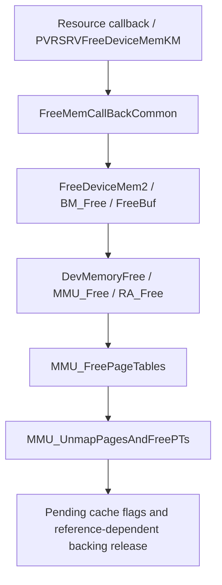

# Linux EMGD sync, cleanup and release

Linux EMGD has several completion-related mechanisms with different scopes.
A sync threshold, a cleanup callback return and release of backing are not one
certificate. This chapter uses the Linux EMGD 1.8 Build 2032 components in
[Sources](../sources.md), matched kernel source and compiled function analysis.

## A sync query selects a use threshold

`PVRSRVAllocSyncInfoKM` allocates 24 bytes of sync data with the selected
cache-consistent flag, initializes counters and binds complete addresses at
allocation byte offsets 4 and 12. `sgxkick.c` retains references, copies expected
counter values into the firmware-facing shared block and increments pending
counters for that task.

The compiled `SGX2DQueryBlitsCompleteKM` snapshots read-pending and write-pending
at query entry. It compares current complete values with those snapshots using
unsigned greater-than-or-equal. It returns zero when both thresholds are met,
`0x15` for a nonwaiting pending query, and `0x0d` on a waiting timeout. Work
submitted later is outside the original snapshot. There is no wrap-safe
subtraction in this implementation, so counter wrap handling remains unproved.

Some complete-counter producers run on the CPU. `ModifyCompleteSyncOpsCallBack`
waits for old snapshots and increments selected counters;
`PVRSRVCommandCompleteKM` updates queue counters. Assignments under
`NO_HARDWARE` are another path. SGX attribution requires the actual task,
sync-object identity, expected value and producer. A changing value or PID
alone is insufficient.

## Cleanup has one shared acknowledgement word

The selected `SGXCleanupRequest` has weak success semantics. The following is
authored explanatory pseudocode for its recovered control flow, rather than
vendor source:

```text
if host_control.power_status has NO_WORK (0x20):
    return
schedule(CLEANUP, object_type, object_GPU_VA)
poll(cleanup_status, mask=1, expected=1, delay=50, attempts=10000)
cleanup_status &= ~1
queue_pending_cache_flags(8)
return
```

The compiled function tests neither the schedule result nor the poll result.
It does not clear status before scheduling. An already-set bit can satisfy
the poll; callback return can follow timeout or scheduling failure. Flag 8 is
an invalidation request, not proof that invalidation completed.

Status is shared at device scope. An attributable acknowledgement needs a
clear prior bit, one matched nonoverlapping request, a new set bit and its
subsequent clear. Context registration and the GPU object address identify the
requested resource. `NO_WORK` bypasses the handshake.

The poll reads volatile host-control memory directly; an MMIO-wrapper trace
cannot supply absent host-control samples. Optional BRN/invalid-status source
branches need confirmation in the exact binary. The kernel uses regparm(3),
so assembly controls argument interpretation when a decompiler disagrees.

## Object cleanup and backing free are separate paths

Cleanup callbacks release their small metadata after the void cleanup call.
Device-memory release follows a separate resource and arena chain:



The arena callback consumes a particular allocation interval and heap page
shift. Shared references, exports and suballocation can delay or combine
release. Process-exit ordering places hardware-context cleanup before mappings
and allocations; that ordering does not prove the unchecked handshake worked.

Normal arena destruction can call `MMU_UnmapPagesAndFreePTs`, whereas an
observer of `MMU_UnmapPages` alone sees a different leaf. Zero hits in one
function do not establish that no unmapping occurred. The selected leaf clears
PTEs and queues invalidation; it introduces no new drain predicate. Owner
metadata must be sampled while references are live, not through freed pointers.

## Observation and acknowledgement boundary

A kind-3 POWER envelope is not kind-4 CLEANUP, and teardown entry arguments do
not establish a fresh firmware acknowledgement or exact release extent.
Uninstrumented intervals and exhausted return-probe pools make the absence of
an event inconclusive. Module load/unload without active rendering is not
post-render resource retirement.

Cache request bits can change during scheduler filling. This identifies a host
mutation, not device consumption, visibility or final GPU use. The unpatched
carrier selects cleanup service `0x271`; its final device-memory write and
cache ordering remain unresolved by the host analysis.

The distinct [PSB normal-success contract](../psb/normal-success-lifetime.md)
does reach real page freeing and incompatible USE-bank replacement. EMGD's
unresolved firmware consumer does not invalidate that separate successful
source path or introduce a global-idle requirement into it. WB image cache
handoff and last display use remain additional contracts in either case.

## Exact compiled ranges

These file ranges use the matched `emgd.ko` hash in [Sources](../sources.md).
The module is relocatable: analysis addresses are not live kernel addresses.

| Function | File start | Bytes | SHA-256 |
| --- | --- | ---: | --- |
| `SGXCleanupRequest` | `0x47b50` | 399 | `35c070d675c709cf7ba2b2fcabdc69875157682cd4feb14b332d339be14de55e` |
| Query, first range | `0x48010` | 55 | `df702be8b8253dce64fa8884e1a257f8d7cd7c12f4ef7e5f15c6fbccb59369bf` |
| Query, second range | `0x48048` | 116 | `d5baf1dbc553606964306f94ed48ade3fd02df7f260b65e48d3b94e8151e87bb` |
| Query, third range | `0x480c0` | 13 | `66a3fa69188365b361839d8735dd771d3def567c6f262ec9fae9bc06cda8a352` |
| `MMU_UnmapPages` | `0x49480` | 137 | `3c3ec4cde1916bbee20738d949f95a5caa380b44a3f6676057c5863b5ee08118` |

The implementation rule is
to preserve errors and owners after uncertain publication or cleanup, rather
than reproduce the legacy ignored-error branches.
