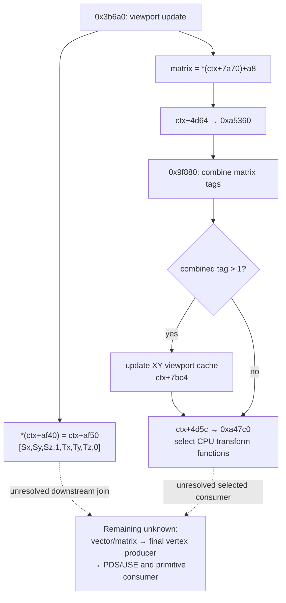

# Viewport coordinates and the matrix callback

The Linux EMGD 1.8 viewport path has an authenticated callback target: context `+0x4d64` selects
`0xa5360` on the recovered initialization branch. It refreshes matrix classification and cached
transformation state. It is not the final primitive upload, and its second argument is not the
viewport vector. This distinction changes where the remaining W and coverage investigation
should continue.

All findings here are **STATIC**, with independent checks of the original ELF bytes and address
arithmetic. The retained runtime captures do not observe this context's matrix fields, callback
invocation or final transformed vertex stream. This chapter therefore does not qualify general
W, a coverage rule or the current poulsback renderer.

- [Callback installation](#callback-installation-and-relocation) and [its two inputs](#two-outputs-of-the-viewport-update)
- [Matrix cache updates](#what-0xa5360-actually-does) and [CPU function selection](#the-next-callback-selects-cpu-transformation-functions)
- [Remaining native consumer](#next-bounded-question)

## Exact target and coordinate systems

The reference is the Ubuntu 11.04 EMGD 1.8 `libEMGDOGL.so`:

- Size: **2,791,512 bytes**.
- SHA256: `3c701b634887fa1fd719825bda8db01961f30f744fb6a9f84c5728163282bc8a`.

See [source families](../sources.md#linux-emgd-18) for the matched component selection.

Unless labelled otherwise, addresses below are **Ghidra analysis byte VAs**. For this import,
`analysis VA = original ELF VA + 0x10000`. The examined code is in the first `PT_LOAD`, where
ELF VA also equals file offset. This equality does not hold for all data: the writable `PT_LOAD`
has ELF VA `0x29ba2c` and file offset `0x29aa2c`. Context and matrix offsets are CPU byte
offsets; none is an SGX register number or a GPU virtual address.

## Callback installation and relocation

The instruction storing callback `+0x4d64` begins at analysis **`0xa5c5b`**, ELF/file offset
**`0x95c5b`**. A literal search for the displacement bytes `64 4d 00 00` instead returns
`0xa5c5d`, two bytes into the instruction. A byte match must not be treated as an instruction
boundary.

The original instruction bytes establish the installation:

| Original ELF VA / file offset | Original bytes | Effect |
| --- | --- | --- |
| `0x95bf1` | `e8 22 2f f9 ff` | Call PC thunk at `0x28b18` |
| `0x28b18` | `8b 0c 24 c3` | Put the caller's return address in ECX |
| `0x95bf6` | `81 c1 9e d6 20 00` | ECX becomes `0x95bf6 + 0x20d69e = 0x2a3294` |
| `0x95c55` | `8d 91 cc 20 df ff` | EDX becomes `0x2a3294 - 0x20df34 = 0x95360` |
| `0x95c5b` | `89 90 64 4d 00 00` | Store EDX at `[context + 0x4d64]` |

`0x95360` is the original ELF VA of analysis entry `0xa5360`. This installation uses the actual
context argument, not the allocation's shifted alignment base and not a block copy.

The retained `MakeCurrent` implementation at `0x3a300` supplies reachability: instruction
`0x3a58f` calls `0xa5bf0`. The selected branch requires the context not to be inside `Begin`,
`ctx+0x5c` bit 1 clear, and `*(u32 *)(**(u32 **)(ctx+0x7e0c)+0x3c) != 1`. These raw conditions
are retained; the last field's complete original type is not recovered here. The branch is not a
claim that every EMGD context uses the same callback installation.

## Two outputs of the viewport update

The [geometry
chapter](geometry-and-sampling.md#viewport-coordinate-vector-and-matrix-update-branch) describes
viewport calculation. The update has two different outputs:



The final call in `0x3b6a0` is:

```text
callback(ctx, *(ctx+0x7a70) + 0xa8)
```

Its second argument addresses an existing matrix object. It is not `*(ctx+0xaf40)` or
`ctx+0xaf50`. The matrix loader's already retained GL `MODELVIEW`/`PROJECTION` branches use
`ctx+0x7a70` and `ctx+0x7b44` respectively. Their combined numeric matrix and the compact
viewport vector have different storage and different consumers. Writing the vector immediately
before the callback is not an alias or a data-flow proof.

## What `0xa5360` actually does

The callback body is `0xa5360..0xa5438`, inclusive, 217 bytes.

First it calls `0x9f880(matrix, *(ctx+0x7a70), *(ctx+0x7b44))`. The helper shows **tag
propagation**, not floating-point matrix multiplication. It reads the two input objects' DWORD
tags at `+0x40`, produces the destination tag and, for selected cases, copies two 16-bit
metadata fields at `+0x44/+0x46`. The operation combines tags, rather than multiplying numeric
matrices.

For example, input tag 0 yields destination tag 0; input tag 1 yields whether the other tag is
nonzero; tags 2 and 3 cap the other tag at 2 or 3. Tags 4 and 5 have additional metadata cases.
Assigning original symbolic names to all six tags remains open.

When the resulting unsigned tag is greater than one, the callback builds a viewport-adjusted
cache at `ctx+0x7bc4`. Let `M[i]` denote matrix float index i, with the raw DWORD tag separately
at byte `+0x40`. Let `C = ctx+0x7bc4`. The stores visible in the complete body are:

| Cache byte offset | Value written |
| --- | --- |
| `C+0x00`, `C+0x10` | `M[0]*Sx`, `M[4]*Sx` |
| `C+0x04`, `C+0x14` | `M[1]*Sy`, `M[5]*Sy` |
| `C+0x28` | Copy `M[10]` |
| `C+0x30`, `C+0x34` | `M[12]*Sx+Tx`, `M[13]*Sy+Ty` |
| `C+0x38` | Copy `M[14]` |
| `C+0x3c` | F32 `1.0`, raw `0x3f800000` |
| `C+0x40` | Copy raw matrix tag |

These operations use the x87 CPU path and store F32 results. Only the listed fields are written
here; unlisted cache fields must not be treated as zeroed. The `1.0` store is a field in this
conditional matrix cache, not proof that every output vertex has W=1 or that the GPU can omit
reciprocal W. This function contains no reciprocal calculation and no final vertex
serialization. It does not apply the separate Sz/Tz vector to Z in these stores.

Finally, it calls `ctx+0x4d5c(ctx, matrix)` unconditionally. The same installer sets this slot
to `0xa47c0`.

## The next callback selects CPU transformation functions

The available function-boundary analysis does not certify a full procedure extent at `0xa47c0`.
The selected instruction slice below supports the stated pointer selection without implying a
recovered full function.

Independent original-byte decoding establishes a smaller, sufficient result. The code reads the
second argument and its DWORD tag at `+0x40`, rejects tags above 5, then indexes six signed
offsets at ELF VA/file offset `0x272da0`. Each selected branch writes three function pointers
into the matrix object:

| Tag | Branch ELF VA | Matrix fields written |
| --- | --- | --- |
| 0 | `0x94848` | `+0x48`, `+0x4c`, `+0x50` |
| 1 | `0x94828` | `+0x48`, `+0x4c`, `+0x50` |
| 2 | `0x94808` | `+0x48`, `+0x4c`, `+0x50` |
| 3, 4, 5 | `0x947e8` | `+0x48`, `+0x4c`, `+0x50` |

The source pointers come from process data reached through the GOT. The [selected targets and
CPU callers](../sgx535/edge-w-contract.md#resolved-matrix-function-pointers) are resolved.
That follow-through also identifies a non-`GL_RENDER` selection; it does not turn the CPU
coordinate helper into a native vertex serializer. The checked instruction slice `ELF
0x947c0..0x94864` is 165 bytes, SHA256
`decfe6666d24eb09fa28da810e95a46005c221d10884088ab8f18ceb12102a39`. This is a manually selected
reachable slice through the branch returns, **not** a provider-certified full function extent.

The callback chain therefore selects CPU matrix transformation procedures. It does not itself
write PDS, USE, MTE, ISP state or a GPU command buffer. Whether a later selected CPU procedure
produces the exact vertex stream sent to SGX remains a separate producer-to-consumer join.

## Consequences for W, depth and the edge discrepancy

The callback chain rules out a misleading shortcut: treating callback `+0x4d64` as the missing
hardware dispatch would send the investigation to the wrong interface. It also shows why a fixed
W-looking matrix field or a viewport setter cannot establish the final interpolation contract.

The compact viewport vector still has eight F32 words: `[Sx,Sy,Sz,1,Tx,Ty,Tz,0]`. Its selected
XY formula adds no extra half-pixel term. The [depth
chapter](../windows/depth-state-and-storage.md) traces Sz/Tz and their initialized scaling
separately. Neither prefix proves that a later consumer adds no offset, changes no winding, or
uses a particular tie-breaking rule.

No hardware interpolation precision, PACK rounding law or exact coverage rule
follows from these source transforms. A numerical model needs an independently
specified domain and complete input/output interpretation.

## Next bounded question

The [coordinate follow-through](../sgx535/edge-w-contract.md#resolved-matrix-function-pointers)
owns the resolved pointer table, CPU reciprocal/window stores and their selection limits.
The native route follows descriptor
`ctx+0xc02c` under the alternative `ctx+0x23b0` callback, converter pointer at record `+0x24`
and the allocated output cursor reached through `ctx+0xc218`. That [attribute-upload
chain](../sgx535/edge-w-contract.md#native-attribute-upload-and-dma-consumer) reaches native
input-program stores; final USE output and primitive-state semantics remain separate.

Only after that source chain selects competing models should a retained capture or a new bounded
device discriminator be used to decide between them. The existing TA/CCB trace observes
publication at another layer; it has no matrix identity or vertex-payload join that answers this
question.
