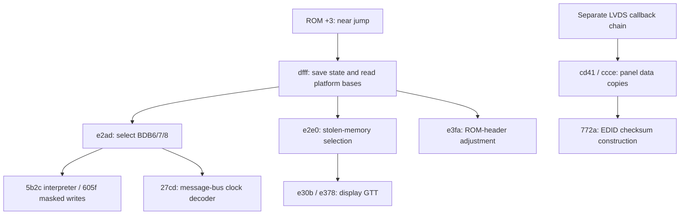

# BIOS display preparation, clocks and power

Dell Inspiron 1210 firmware explains selected display, memory and power state
that a driver may inherit. The findings below combine static A01/A02/A04
artifacts with separately retained registered metadata. Reachability in an option
ROM does not establish that its OEM branch executed on a particular machine.
These are firmware and legacy observations, not fresh poulsback hardware tests.

The related [configuration chapter](configuration-controls.md) separates Windows
UI/COM/SDK requests from physical effects. [Address domains](../address-domains.md)
separates display GTT, PCI, host and SGX addresses; [source families](../sources.md)
identifies the selected artifacts.

Reading routes: [ROM identity](#exact-option-roms), [POST tables](#post-and-table-interpretation),
[panel/EDID](#panel-timing-and-the-cached-edid), [display GTT](#display-gtt-arithmetic),
[flip completion](#synchronous-flips-and-old-image-release),
[extraction](#extraction-boundaries), [clocks](#clock-transport-and-competing-decoders),
[ACPI/power](#a04-acpi-and-power-interpretation) and
[performance interpretation](#correctness-and-performance-need-separate-results).

## Exact option ROMs

Each selected graphics option ROM is 65,536 bytes, PCI vendor/device `8086:8108`,
x86 code type 0. These hashes identify extracted option ROMs, not whole update
executables or a readback of live flash:

| Release | Option ROM SHA-256 | Relationship |
| --- | --- | --- |
| Dell A01 | `cd9d3559cbeae7fe8afbd8443605977b0d67a3b43e06386423e676d95d1d98f1` | Differs from A02 at 61 bytes: VBT checksum byte and 60 BDB46 bytes. |
| Dell A02 | `dad81a9f026ba502cd65388932262c0d011b9b6758fa1077cf1052dd2e3b4c19` | Selected static analysis input. |
| Dell A04 | `dad81a9f026ba502cd65388932262c0d011b9b6758fa1077cf1052dd2e3b4c19` | Byte-identical VBIOS to A02; system BIOS and ACPI can differ. |

Identical VBIOS bytes in several OEM packages represent one code lineage.
Acquisition of an update does not establish a vendor-signature check or live
flash identity.

The VBT occupies ROM `[0x0ae0,0x250a)`: 6,698 bytes, version 100. The BDB is at
VBT+`0x30`, version 131. These are legacy formats; equally numbered modern i915
blocks need not have the same meaning. Whole-ROM byte sums are zero, while each
selected static VBT sums to 205 modulo 256. Those original checksums describe
the input; a parser must not silently repair bytes to accept it.

## POST and table interpretation

The selected real-mode analysis uses `x86:LE:16:Real Mode`, image base
`0000:0000`, ROM CS=0. Within that mapping, `0000:xxxx` denotes ROM file offset
`0xxxxx`; it does not describe live segment registers, shadow-ROM placement,
PCI addresses or GPU VAs. Names such as `probe_e2ad` are research labels.

The arrows describe selected static call/data flow. The separate LVDS chain
is not a proved POST/OEM callback selection.

ROM+3 is a near jump to `0xdfff`, not a call despite an automatic call-like
classification in the saved analysis. POST reads graphics I/O BAR1 through PCI
register `0x14` and masks it with `0xfff8`. It derives the LPC PM timer base from
register `0x40`, adding 8. Timer sampling does not establish SGX completion or
MMU drain.

Caller `e2ad` supplies ROM offsets `0x0d7e`, `0x0ede`, `0x0ee8` to interpreter
`5b2c`: the BDB6/7/8 programs have 43/1/7 decoded operations. They use the
display graphics I/O index/data interface. Helper `605f` combines old and desired
values as `new = (old & ~mask) | (desired & mask)`, with width/byte placement.
Even a selected full-width write reads the prior value. Registers with read
side effects cannot be treated as interchangeable memory cells; offset zero
in a display table is not SGX CLKGATECTL by numerical coincidence.

Useful selected function ranges, end inclusive, are `dfff..e09f`,
`e2ad..e2d7`, `5b2c..5bcc`, `605f..60cb`, `27cd..286e`, `e30b..e377`,
`772a..7779`, `cd41..ce90` and `e3fa..e445`. Their byte mappings identify
static code, not executed branches.

## Panel timing and the cached EDID

BDB42 contains panel timing; BDB46 contains sixteen 128-byte EDID-shaped
templates. The `cd41`/`ccce` chain copies panel data. A direct call at ROM
`0xcac3` reaches `0xcd41`, but the complete POST/OEM-to-callback path remains
unproved. Procedure `772a` constructs EDID byte 127 from the preceding
127 bytes. A derived checksum-correct block is not a captured DDC transaction.

The raw BDB42 and checksum-completed BDB46 descriptions differ:

| Description | Pixel clock | Totals | Calculated nominal refresh |
| --- | ---: | --- | ---: |
| Raw BDB42 | 68,900 kHz | 1440×823 | 58.1376 Hz |
| Derived BDB46 template | 70,100 kHz | 1419×823 | 60.0255 Hz |

Both describe 1280×800 active pixels. A matching cached description does not
prove current VBT bytes, DDC provenance, actual refresh or execution of the
proposed copy branch. A KMS mode path should consume the
registered display description rather than assume the raw ROM timing is active.

## Display GTT arithmetic

POST uses GMCH register `0x52`, aperture selector `0x62`, BSM `0x5c` and display
PGETBL_CTL offset `0x2020`. This is display translation, separate from SGX's
page-directory owner.

For GTT physical base `G`, the selected construction loop's ordinary repeated
tail PTE maps `G−8192`; the final PTE maps `G−4096`. EAX reaches `G` only after
the last store. Reading that post-store register value as the final PTE would
be an off-by-one-page error. This follows from the selected store/increment
order; a CPU model of that arithmetic does not observe a running display GTT.

Another unit trap appears in an inherited Linux clear loop: counting GTT
storage pages and clearing that many u32 entries does not clear the aperture.
For a 256 MiB aperture with a 64-page GTT, that mistake touches 64 entries
instead of 65,536 active entries. Storage capacity, active PTE count and
aperture bytes must be tracked separately. Rebuild/restore errors must be
propagated before later IRQ/display stages.

Firmware display mappings, SGX mappings and shown buffers also have
different last-use rules. A framebuffer can remain under display fetch after
a rendering notification; knowing GTT layout supplies no release fence.

## Synchronous flips and old-image release

The Linux 6.1 PSB path in `gma_display.c::gma_pipe_set_base` writes an
aperture-relative byte offset to the selected pipe's BASE register and reads it
back. Its SURF branch belongs to other chips. GTT insertion/removal in `gtt.c`
uses page indices, serialized stores and a posted-write readback. Neither
readback identifies the last memory fetch from a replaced image.
`gma_wait_for_vblank` is a fixed delay; the IRQ event path does not authenticate
a particular image or replacement serial.

The [matched EMGD 1.8 source](../sources.md#linux-emgd-18) provides a more explicit
synchronous route: `emgddc_process_flip` → `emgddc_flip` →
`igd_set_surface_plb`, followed by `emgddc_process_flip_queue_for_vblank`.
The selected PLB producer writes the surface byte offset to plane+4. The queue
marks an already-flipped item complete on a later vblank callback. The separate
`set_flip_pending_plb` / `check_flip_pending_plb` route emulates pending state
with per-pipe vblank requests; it is not a hardware flip-pending register.

The selected `mode_plb.c:1416–1440` IRQ path reads IIR before taking the vblank
request lock. Stale PIPESTAT/IIR is cleared only when newly enabling that pipe's
request (`1525–1557`). This ordering does not exclude an already sampled
pre-BASE interrupt from answering a later software request; a later callback
alone does not establish a post-BASE event for the replaced image. The Linux
stable 24-bit frame-counter reader also remains unjoined to BASE latch and the
last old-image fetch.

These are source-derived scheduling rules. The same displayclass completion
callback is also used for flush, zero swap interval, invalidated swapchains and
suspension, including paths without a physical flip. A callback name or success
argument therefore cannot certify scanout or memory release. A native provider
needs its own post-store transition tied to the pipe and the replacement before
withdrawing the old image's PTEs or signalling its display READ fence;
poulsback's frame-counter rule is in
[display](../../kernel/display.md#static-source-and-cache-custody). Plane disable
has the same old-image lifetime requirement.

The allocator and physical-release consumers are distinct too. For the last
flipchain, the matched `emgd_dc.c:1056–1099` destruction path disables its
callback, flushes pending flips, requests the system buffer and calls
`free_swap_chain` without a newly attributed display event. That reaches
`gmm_free` (`gmm.c:77–121`),
which drops CPU mappings/address metadata and marks the chunk unused while
retaining its backing and GTT mapping. `gmm_alloc_chunk_space` (`610–639`) can
reuse that storage and offset without an event check. Physical GTT removal and
page freeing belong to `gmm_shutdown` (`461–501`); its caller's complete
quiescence contract remains unjoined. This is a source finding, not an observed
EMGD use-after-free or a release certificate for poulsback.

The selected plane-disable helper in `micro_mode_plb.c:507–555` writes disabled
control, retriggers the start register and calls the vblank waiter, but ignores
the wait result. The waiter (`231–286`) can report success without an event
when the pipe is off or VGA is on, and can report a timeout. Those branches do
not establish that outstanding old-image reads drained. Poulsback's
[display owner](../../kernel/display.md#static-source-and-cache-custody) does not
rely on such a callback. It records the pipe's frame counter right after the
`DSPBASE` store that replaces an image and certifies the old image once the
counter, with the pipe enabled, is at least two past that value (HW-DISP-004/005);
only then are its PTEs withdrawn and its READ fence signalled. A never-shown
image is certified at once; an ambiguous switch or withdrawal enters HOLD.

## Extraction boundaries

A Phoenix extractor must reject unaligned/out-of-bounds reads, unterminated
module names, duplicate output basenames and FFV lengths that omit the final
byte. A successful process exit alone does not establish a complete option ROM.

The checked interpretation uses the exact FFV record index, 24-byte header,
encoded LE24 extent, validated bounds and names derived from original offsets.
Full 65,536-byte `_R00` bytes agree with an independent PCI-ROM carve.
Compressed ACPI is checked separately by declared length/checksum; that does
not establish correct decoding of every compressed module or the entire BIOS.

## Clock transport and competing decoders

For the measured clock interval, ISR render state and X presentation route,
see the [runtime render-state contract](runtime-render-state.md). The decoder
conflict below retains its own source/stepping scope.

ROM procedure `27cd` uses PCI mechanism 1 selector/data ports `0xcf8/0xcfc`
to reach the SCH message bus. Request `0xd0020100` tests bit 23; when set it
selects a nominal decoder value of 250. Otherwise it reads `0xd0050300`, takes
the low three selector bits and indexes a table. For selectors 6/7 the ROM
returns 200, while the selected Linux `gma_get_core_freq()` decoder returns
266. The special 250 branch also differs.

VBIOS and ACPI `RMBR/WMBR` corroborate the transport, not the applicable decoder
for every stepping. Retain raw selector, stepping, decoder and reported value
independently from an actual frequency measurement. Reading this bus writes a
selector and requires serialization; it is not a harmless unsynchronized read.
The discrepancy alone establishes no clock-control change or performance gain.

## A04 ACPI and power interpretation

The static A04 DSDT adds `BPU0`, EC bit 7 at offset `0xfa`. `_BIF` uses it as
the battery-unit selector and multiplies design/full capacity by 10 only when
`BPU0==0`. `_BST` conversions likewise depend on the selected unit path; one
unconditional capacity/rate scale is incorrect.

`ACAD._PSR` returns the EC adapter flag when `ECOK()` succeeds, otherwise One
(AC present). `_Q37/_Q38` notify ACAD, sleep 1000 ms, then notify BAT1. These
are static method bodies, not evidence that the analysis executed AML methods.

Runtime ACPI can relocate GNVS and IGDM regions without changing the method
bodies. A table's checksum and declared region base/length do not establish a
valid live mapping or permission to dereference RAM. Resolve runtime bindings
independently from static firmware placeholders; checking ACPI table extents
also does not authorize unrelated ROM, OpRegion, RAM or MMIO reads.

AC state and CPU sensors have platform-specific units and coverage. Missing
samples or asynchronous AC/battery notifications cannot diagnose adapter
failure, GPU throttling or warm-reboot/PXE behavior. A CPU temperature, CPU
frequency or AC-online report is not a GPU sensor or decode-throughput counter.

## Correctness and performance need separate results

Keep input/application, dimensions, formats, depth/sample state, filtering,
swap interval and presentation path fixed or state their differences. Actual
loaded components identify the implementation; product names alone do not.
Report observer overhead, warm-up and the measurement interval.

| Quantity | Required interpretation |
| --- | --- |
| Application FPS | Completed application frames per stated clock interval, separate from GPU or presented frames. |
| GPU latency/throughput | Submission identity, observed completion, errors and duplicates within the calibrated clock's precision. |
| Presentation | Actual presentation and copy/flip/refresh behavior, rather than swap-call count. |
| CPU/memory cost | CPU time, allocations, retained owners, pressure and copies. |
| Power/clock | Raw unit and decoder provenance, AC transitions and available thermal coverage. |
| Video | Decode, transfer/readback, conversion, presentation and dropped frames separately. |

Do not merge stable-AC and transition intervals into a peak-rate claim.
Instrumentation overhead does not by itself establish a hardware limit, and
power instability does not excuse incorrect pixels. Telemetry without matching
workload, timing, presentation and source identities does not form a normalized
cross-stack benchmark.

Remaining joins are the active clock policy for the selected stepping,
runtime PM drain/acknowledgement and display-state preservation, ROM-shadow
mutation, the full OEM panel callback, and final display fetch. The ROM provides
neither an SGX microkernel nor an MTX completion/retirement proof.
