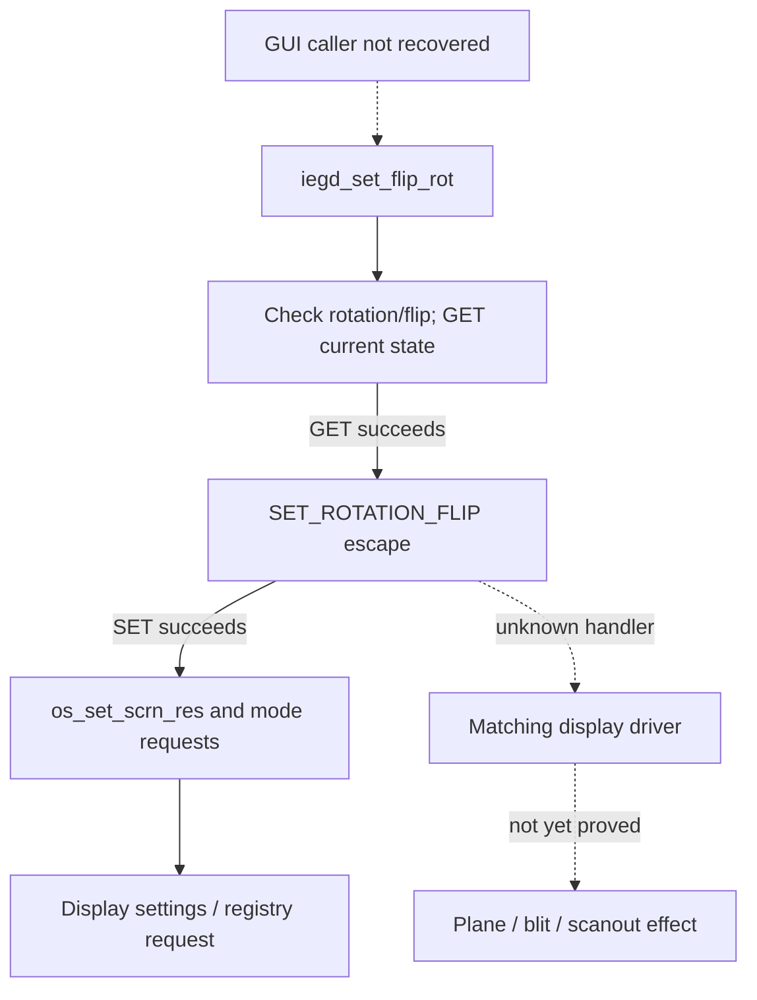

# Configuration controls: request, persistence and hardware effect

The selected Windows material contains two different control stacks: Win7
EMGD `8.14.1180.3398` uses Intel CUI/COM components, while XP EMGD
`1.14.0.2443` includes a GUI and HAL/OAL SDK. A label, registered interface,
successful API return and completed hardware transition are different facts.
The XP source is not a recovered implementation of Win7's CPL.

The arrows identify the required joins, not universal recovered coverage.
Persistence may feed a later mode set, and an API return can precede a
transition. [Source families](../sources.md) separates the packages;
[BIOS/display/power](bios-display-power.md) covers another layer of configuration.
No Windows GUI or native component was executed to establish the static findings
below.

Reading routes: [Win7 components](#win7-3398-components),
[CPL resources and launch](#resource-lookup-and-native-launch),
[Settings/Power calls](#actual-settings-and-power-calls),
[XP SDK identity](#xp-2443-package-and-sdk-identities),
[rotation request](#xp-rotation-validation-escape-mode-application) and
[remaining power joins](#power-controls-and-remaining-joins).

## Win7 3398 components

The exact `igdlh32.inf` is 33,040 bytes, SHA-256
`11ad54ee42919cb501ceeab2144ade31f1318a40017a09f63e3a2f2f9b277c9b`.
Its `IEMGD_HEAD_Windows7/LPCO` components have the following identities:

| Component | Bytes | SHA-256 | Declared or inspected role |
| --- | ---: | --- | --- |
| `igfxcpl.cpl` | 313,856 | `488301cac47dcec4e58d944198dc4ded799a2404cafec4a387ab6821b249b19e` | CPL; resource strings name `igfxres.dll`. The selected resource tree has no in-file dialog. |
| `igfxcfg.exe` | 920,064 | `1bad2bf95f4b5756d9df8f7d157e6355b1f4780d06e1e31962e5a5b9941dbd4b` | INF registers DataObject/ShellExt COM local servers and launch resources. |
| `igfxsrvc.exe` | 500,736 | `4d07d9dfc1795d8575c25197c48f02e1a11ffdcd6c3495e5d49fc7f3b320bb97` | Registered Settings, DisplayConfig, EDID, Color, Rotation and other interfaces. |
| `igfxsrvc.dll` | 44,032 | `35b09e5042157642ed8ae3f20ec942d8dc0c370d0ad5de496e0b8aec99b1e86b` | Explicit proxy/stub registration. |
| `igfxpph.dll` | 190,976 | `a3b093b79204b2143b26f6ab852f78e996c529ac8d153bc6c944486f9eb866a9` | Display property-sheet route and associated resources. |
| `igfxres.dll` | 369,152 | `cf4bc16c8ad120012dfd41cffcdfa3738f569fd7d49ad83bcfe59c81954fdf21` | Resource companion named by the CPL; runtime loading is unobserved. |
| `igfxress.dll` | 3,469,824 | `5a1a453995ea1e0719a0849358555ff5f672d9031c918401df606952183841f7` | Shipped resource companion; no complete UI interpretation is claimed. |

The INF declares:

- ICD registration `OpenGLDriverName=igdogl32.dll`, `OpenGLVersion=1`,
  `OpenGLFlags=1`; these are installation values, not GL version/conformance.
- Device-relative `ALL\1\Port\2\General`, `Rotation`, DWORD 0; the applicable
  configuration and port remain part of the meaning.
- A display property-sheet route, CUI resource 468 pointing to `igfxcfg.exe`,
  tray default `ShowTrayIcon=1`, and DataObject/ShellExt local servers.
- Rotation class `{9B908879-E03F-4D0C-ACB3-9065B1155460}`, local server
  `igfxsrvc.exe`, interface `{72DC5954-069D-43C4-9B8B-19B59269DC74}`
  (`IRotation`). This identifies an analysis target, not recovered arguments or
  a GPU consumer.
- Blank resource entries annotated OpenGL 3D and Dual Frequency Power Settings.
  A hidden control says nothing by itself about shader capability or a usable
  frequency API.

In that exact INF, ICD/default declarations are at lines `227–239`, launch
and local-server declarations at `302–353`, rotation registrations at
`441–448` and `495`, and blanked resources at `627–639`. Settings/Power GUID
registrations used below are at `358–365` and `405–412`. These locators describe
the selected source revision, not runtime calls or PE addresses.

### Resource lookup and native launch

The selected CPL has four resources in its bounded 12-entry directory tree:

| Type / name / language | PE RVA | File offset / bytes | Payload SHA-256 |
| --- | --- | --- | --- |
| TYPELIB / 1 / 1033 | `0x4f478` | 299128 / 1232 | `675d6a600efaeca8d9aa5e426e16759b2ddcb3782b1631dbf007e33ed16b0fb9` |
| STRING / 7 / 1033 | `0x4fd70` | 301424 / 140 | `fb8b4327e6580a98ad8693693901cd9bcf2bbc0bf36150b4313ffc8c311726ed` |
| VERSION / 1 / 1033 | `0x4f948` | 300360 / 1064 | `3fbd9a1ae8b85b489e73c847529f0a5c2a8208dba4de20fae81b2e4719e05822` |
| MANIFEST / 2 / 1033 | `0x4f280` | 298624 / 499 | `35ee0b2cd8afe12790807cf996c056981e2a170d68db7b2a2653c9d725859a9b` |

Length-prefixed UTF-16 entries include ID 102 `igfxres.dll`, ID 104 `igfxr`,
ID 105 `.lrc`, ID 106 `igfxh` and ID 107 `.lhp`. Inspecting the `.cpl` alone
cannot map every control or establish the language/help resource loaded at
runtime. The selected TYPELIB and VERSION contents remain uninterpreted.

`CPlApplet` at preferred PE VA `0x100010a5` jumps to dispatch body
`0x10005493..0x10005778`, end inclusive. Preferred base is `0x10000000`,
with `.text` RVA `0x1000` / file offset `0x400`; entry file offsets are
`0x4a5` and `0x4893`. These are static mappings, not live addresses.

The message-5 branch loads string `0xb7e` (2942) and passes it to helper
`0x10002163..0x100021fa`. That helper tries `CreateProcessA`, then
`ShellExecuteExA` on failure, and returns null if both fail. The dispatcher
closes a returned process handle; it does not wait for successful UI operation.
The actual program path depends on external `hccutils!LoadSTRING`. INF resource
468 and string 2942 cannot be treated as interchangeable selectors.

### Actual Settings and Power calls

In message 2, the dispatcher initializes COM, creates `ISettings`, and calls
vtable offset `0x10` with a 24-byte buffer. It continues only for a nonnegative
result and nonzero DWORD at buffer `+0x10`. The qualifying branch creates
`ICUIPower`, calls vtable `0x10` with a zero-initialized 48-byte buffer, then
calls vtable `0x14` with the same buffer and a final zero argument. On successful
creation it releases both interfaces and uninitializes COM. The caller does
not test the two power-method return values.

| Constant | Preferred PE VA / file offset | GUID |
| --- | --- | --- |
| Settings class | `0x1003d448` / `0x3c248` | `{078AEF33-C48A-49F7-AFF3-A0EE810BFE7C}` |
| Settings interface | `0x1003d378` / `0x3c178` | `{916FEC45-8FAB-460F-9BD1-325055E3DEC9}` |
| Power class | `0x1003d468` / `0x3c268` | `{C332C124-340D-4430-AA0D-C75602876FCC}` |
| Power interface | `0x1003d398` / `0x3c198` | `{299D88F9-2CBD-4225-BF19-FCD164C54C3F}` |

This native call coexists with the blanked power-setting resource. Neither
fact establishes an accessible frequency control. Method names, buffer fields,
persistence, service/escape transport, matching KMD handler and chipset effect
remain unknown. The dispatcher sets EAX before returning even though an inferred
decompiler signature describes it as `void`; that signature is not the exported
API declaration.

The actual Win7 rotation event handler and registered `IRotation` implementation
also remain unjoined to an escape/driver consumer. XP's source path below cannot
fill that gap merely because both interfaces expose rotation.

## XP 2443 package and SDK identities

The selected normal carrier is `xp-display-iemgd-120628.zip`, 7,432,812 bytes,
SHA-256 `467f16f1b3522326460bf120850b61cc0da2960db1d8f63e4440eb9e50962112`.
The separate headless carrier is 7,434,597 bytes,
SHA-256 `227c24b0bb28a189f11aab8382e3bf3b2e2b16e77e1b9fb58e44c7e1cd3488d0`.
Both identify version `1.14.0.2443`; only the normal package is selected here.

| Component | Bytes | SHA-256 |
| --- | ---: | --- |
| `Utilities/EMGDGUI.exe` | 315,392 | `961006d28b0e45369ac104fdb2b7862d4b2bf8e9144e1592ed1a1acc4443bd7a` |
| `Utilities/emgdgui.dll` | 344,064 | `7fc08b196fe757946280eeaa5d2e2ba241acd6c8f75c2d4f72da5e5622c6447c` |
| `Utilities/emgdui.dll` | 475,136 | `5781bf2c68e4699bc069adf10f3140aed4010e05bd53a51e8705741ecce36b49` |
| `Driver/iegddis.dll` | 512,896 | `41d4f4286f67a755f1ac8ac51e21f6302d3f0e043194d36c31c2da24cf34b584` |
| `Driver/iegdmini.sys` | 2,435,072 | `b50391ddc92b1d181f566b49f3cafdbab63add8c8913384eb9a0919cf1ba46e7` |

The shipped SDK source and notices remain with their originals; they are not
reproduced here. Selected source identities are:

| SDK member | Bytes | SHA-256 |
| --- | ---: | --- |
| `hal/src/cmn/hal_interface.cpp` | 83,880 | `f0622782e87d22f026cba29206b1201cd38fd1cac6bf90f2f73696d889677f76` |
| `oal/windows/oswindows.cpp` | 43,513 | `80777c3d0f965111f9683614a0bb8f1a727b6be2e636387505bf510247e95e48` |
| `iegd_escape.h` | 28,328 | `8739e9d13ff27c0876849aab81a9085a3c3c8f105794fda1ffda8e4bd4d81902` |

Source inclusion in the package does not prove that a shipped DLL was built
from that exact revision. Source error paths below remain source findings until
that equivalence is established.

Relevant source ranges in those files are `hal_interface.cpp:1033–1138`
(the outer `else` is at line 1126), export `hal.def:26`,
`iegd_escape.h:61–62` and `330–335`, and `oswindows.cpp:451–558` and `997–1060`.
These line numbers locate the selected source revision, not the shipped DLL.

## XP rotation: validation, escape, mode application

`iegd_set_flip_rot`, exported through `hal.def`, accepts rotation
`0`, `90`, `180`, `270` and the defined no-flip/horizontal-flip values. It first
queries current rotation/flip for a port. GET failure becomes an OS-call or
not-implemented error.

`SET_ROTATION_FLIP=0x2000e` and `GET_ROTATION_FLIP=0x2000f` are private escape
IDs. The set structure has three `unsigned long` fields: port, rotation and
flip. In the intended 32-bit Windows ABI these are three 32-bit values, not
64-bit Linux `unsigned long` or a poulsback UAPI structure.

On the nonsimulation Windows path, `oswindows.cpp` enumerates displays matching
the Intel/EMGD predicates, creates a DC and sends the selected input/output
buffers and sizes through `ExtEscape`. A positive return becomes
`INTEL_ESCAPE_SUCCESS` (zero); a nonpositive return becomes
`INTEL_ESCAPE_ERROR`. The DC is deleted and the loop stops at first success.
No matching display is an error. The simulation branch instead resolves a
function from `g_lib_hdl`, so it is not a display-driver invocation.

After a successful SET, the SDK gets port information and calls
`os_set_scrn_res(ALL_DISPLAYS,0,0,0,0,rotation_delta,force_reset)`. The HAL source
states that private rotation bits do not apply until mode setting. For a
180-degree delta or forced reset, the Windows path can request an intermediate
color-depth change. It then calls the display-settings wrapper with
`CDS_NORESET | CDS_UPDATEREGISTRY | CDS_GLOBAL`, followed by a null-mode call
to apply the settings. This is an OS persistence/application request; the exact
vendor rotation registry key and later consumer remain unproved.

### Source error paths

In `hal_interface.cpp`, the relevant `else` belongs to the outer
`exit_code == EXIT_OK` test rather than the inner SET-success test. If GET
succeeds and SET fails, the inner path can fall through without changing the
initial successful exit code. This is a shipped-source control-flow finding,
not a proven binary bug or an observed Windows incident.

The normal mode-change branch also stores `cd_ret_val`, `cd_ret_val1` and
`cd_ret_val2` without propagating them into its return in that branch. Logs and
a successful SDK return therefore cannot certify physical rotation or completed
scanout use.

## Power controls and remaining joins

Windows COM configuration, Linux Services power and BIOS clock selection answer
different questions. In Linux EMGD 1.8, the initializer produces a POWER service
selector, the bridge copies it and the scheduler publishes it. Two selected
runtime records contain selector `0x207`, but these are power-off requests.
They do not establish final cache drain, an acknowledged low-power state or
reusable allocations. An already-loaded runtime power-on path also differs
from cold initialization.

The useful remaining chains are concrete: the actual Win7 `ICUIPower` methods
and their service/escape/KMD consumers; the Win7 rotation caller/handler;
source-to-binary correspondence for XP; and hardware completion, restoration
and runtime-PM/display preservation for each selected branch. Linux DRM/KMS/PM
needs its own locking, lifetime and error contracts; UI labels or legacy success
returns do not supply them.
