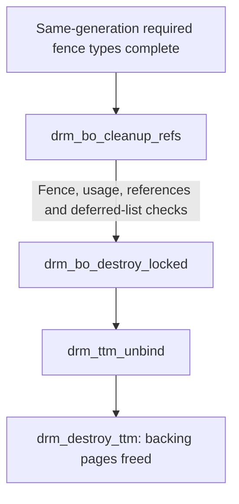

# PSB normal-success resource lifetime

The PSB 4.41 source has an ordinary resource-fence contract reaching real
backing-page freeing and incompatible USE-bank replacement. It requires the
correct event generation, the whole resource-use union, exclusion of remaining
users, and the selected cache/MMU transition. The successful path does not add
a separate global-idle test.

This is a **source-level contract for the selected successful branch**. It is
not a universal minimum silicon theorem, a qualified poulsback lifecycle or a
rule for reviving an uncertain HOLD episode. [Sources](../sources.md) identifies
the source family; it is not silently equated with the deployed Ubuntu PSB
module. The runtime collection uses PSB kernel package 4.42.0, whereas this
normal-success analysis selects source 4.41. A compatible API or nearby version
number does not establish source-to-binary equivalence.

## A submission attaches uses to one generation

`psb_drv.c:947–961` installs the actual fence/backend operations.
`drm_fence_buffer_objects` combines submitted BO requirements, attaches the
same generation's fence to each unfenced BO and retains its required type
mask. `psb_schedule.c:1269–1285` queues the ordinary `TA → RASTER → RETURN`
path, creates the BO fence and fences the USE register manager.

`psb_buffer.c:39–57` selects:

| Resource use | Required normal completion |
| --- | --- |
| Ordinary submitted GPU BO | `EXE \| TA_DONE \| RASTER_DONE` |
| Proven whole-owner TA-only use | May omit `RASTER_DONE` |
| SCENE resource | Adds `SCENE_DONE` |

`EXE` records software submission, not completed pixels. A BO name is not its
use mask: one allocation may serve TA and raster consumers. If fence allocation
fails, `psb_fence_or_sync` can fall back to engine idle. That error fallback is
not an extra normal per-job prerequisite.

## Raster completion and scene completion

`psb_dispatch_raster` reports `RASTER_DONE` on PB_END while deallocation can
still be active. `psb_raster_done` joins raster completion and deallocation
before returning the scene and reporting `SCENE_DONE`.

Both DPM allocations—the table `hw_data` and RASTGEOM `ta_memory`—carry
`PSB_BO_FLAG_SCENE` and are validated against the TA engine. A target-image
fence cannot release a shared DPM pool. Every sharing generation and scene
reference must be accounted for.

If DPM backing moves, scene validation forces the corresponding load/INIT with
the new addresses. Stable compatible backing does not require unconditional
pool reinitialization between frames in this source path.

## From a successful fence to actual page freeing



Translation withdrawal is a related, separate chain:

```text
drm_ttm_evict
  -> installed PSB backend unbind
  -> psb_mmu_remove_pages: owned PTE changes and CPU cache publication
  -> psb_mmu_flush: selected INVALDC or FLUSH
  -> CPU write barrier, control restore and MMIO readback
```

These are concrete downstream consumers. Their flushes satisfy translation
withdrawal; they are not evidence of a newly hypothesized PBE drain predicate.
Removing one lease must preserve neighboring live mappings. A page table
remains owned until its last relevant mapping is gone.

Device/context page-directory teardown separately detaches the selected
hardware directory and flushes before releasing tables and dummy objects.
Completion of a payload BO does not release an active root or borrowed baseline
mapping.

## USE-bank replacement follows the old resource fence

Shader relocation obtains the actual shader BO's fence type. `drm_regs_alloc`
allows compatible same-base/data-master sharing. Before incompatible
replacement, it waits for and checks the old resource fence. `psb_use_reg_set`
changes the base after removal of that fence; `drm_regs_fence` attaches the
new submission generation.

No additional global-3D-idle or USE-IDF step appears in this successful
consumer. This does not remove the need for a native register lease and all
code uses: a completed fragment subrange cannot release a bank used by another
generation.

## Apply completion to whole owners

| Owner | Required accounting |
| --- | --- |
| PDS containing foreground, event and background programs | All TA and raster reads of the shared page |
| Vertex USE also holding state USE | Full use union; “vertex” does not imply TA-only |
| Fragment/event/background USE | Shared owner and bank through every raster consumer |
| Geometry/indices | TA-only optimization needs whole-allocation proof; a conservative full-job join is valid |
| Scene and both DPM areas | Scene completion and exclusion of every sharing scene/generation |
| Color/depth target | Actual submission requirements, plus CPU/cache visibility and display users where applicable |
| PD/PT/dummy/root/source metadata | Separate device/context lifetime |

For a selected isolated job, authenticated TA_DONE, PB_END and DPM FREE can
close its declared packet-owner uses. Reuse or free also needs trustworthy
reference exclusion and exact mapping/cache transitions. A caller's assertion
that no uses remain is not the ownership graph. WB image handoff and last
display fetch have additional contracts; this BO fence does not provide them.

## Error and timeout paths are excluded

The fence error handler can set all signaled types while retaining an error.
Forced lockup cleanup can drop fences. Register-manager teardown can ignore a
wait result. A signaled mask alone therefore does not authenticate normal
success.

A normal-success consumer must check its actual ledger and relevant errors.
It must not import teardown shortcuts, reset `gpu_possible`, or reuse
unpublished cancellation as cleanup of executed work. Partial cache/PAT/PTE
mutation or an identity change after sleep retains the reachable original
graph, with primary and cleanup errors kept separately. An earlier HOLD stays
sealed.

## Source anchors

These ranges belong to the selected PSB 4.41 source package identified in
[source profiles](../sources.md#psb-source-and-runtime-profiles). The public
[source archive](../evidence.md#available-packages) supplies the matching
vendor inputs; verify the complete file before checking a quoted interval.

| File / function | Lines | File byte interval | SHA-256 of interval |
| --- | --- | --- | --- |
| `psb_buffer.c`, `psb_fence_types` | 39–57 | `[1333,1862)` | `971c1f81d65afa7e8b82cc37a4164913fcd6cdee253e719f970ff041f9639a37` |
| `psb_schedule.c`, `psb_dispatch_raster` | 818–853 | `[20873,21890)` | `0ea30c77f44f2b4f996b073d6c4c14f6b55de69cd917146e8c16f6831f7812ca` |
| `psb_schedule.c`, `psb_raster_done` | 474–544 | `[11990,13983)` | `cb42dc0c03b5a644f5b1b7305860d9185542294e692836cdd2832325e0364288` |
| `drm_bo.c`, `drm_bo_cleanup_refs` | 344–398 | `[8557,9892)` | `fd18a3375c70308d4d23079baf966757085e24573890493f07da070c8678cc2c` |
| `drm_ttm.c`, `drm_destroy_ttm` | 190–216 | `[4791,5215)` | `16e7fbad7f1ed00921a47c4f3e3fd83a3ffbb9d4f6e2d109f078e3d0dfd7f62e` |
| `psb_mmu.c`, `psb_mmu_remove_pages` | 741–795 | `[17448,18681)` | `c8ca021ad93397b3cf13860a3e7c8095db3e6ff0d4d3d0d8ceb9bcfcf95f078f` |
| `psb_mmu.c`, `psb_mmu_flush` | 164–185 | `[4289,4941)` | `de2f22a8f2032517d10235d65edc26d43cb07122dd413395904f443ad099c2ca` |
| `drm_regman.c`, `drm_regs_alloc` | 37–115 | `[1587,3286)` | `ff995470f54315823f03f376e3fd8b4bdd23dea9cbeb39c568d9d360633c1c25` |
| `drm_regman.c`, `drm_regs_fence` | 118–157 | `[3319,4258)` | `8665e4d86253fa5220e115b7576e2633fdc4e1aa2fafc8366dec1fca1ce5c628` |
| `psb_regman.c`, `psb_use_reg_set` | 54–81 | `[1665,2485)` | `49d7b68f2cb0f39cafaa6f80e4ca6c21e90768a8af7a7ecab8fb1b4fb4bc48ad` |

The [EMGD cleanup comparison](../emgd-linux/sync-cleanup-and-release.md) uses
Services counters and a shared cleanup word; it must not be spliced into this
PSB sequence. [Hardware](../../hardware.md) and the current
[kernel interfaces](../../kernel.md) separately own applicability and
implementation behavior.
