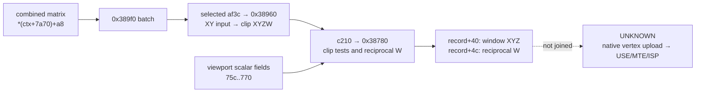
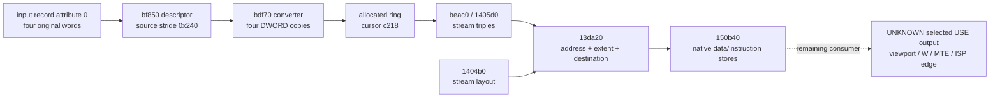

# Clip W, CPU window coordinates and the remaining native boundary

Linux EMGD 1.8 contains a concrete consumer of the recovered viewport fields: it computes
reciprocal clip W, records clip-plane results and writes window XYZ. The selected batch caller
also identifies where its clip XYZW comes from. This closes a CPU coordinate chain beyond the
[matrix-classification callback](../emgd-linux/viewport-coordinate-flow.md). The native
follow-up below reaches attribute upload and emitted DMA controls, but does **not** yet identify
the final vertex-shader output or the SGX edge rule. In particular, a recovered caller selection
installs this CPU batch routine for a mode other than `GL_RENDER`; it must not be promoted to a
native draw path.

The findings below are **STATIC**. Original ELF bytes, relocations and function ranges were
checked independently of decompiler prose. Two exact arithmetic examples check the
interpretation; they do not execute EMGD or qualify the poulsback implementation. There was no
device operation.

- [Matrix targets](#resolved-matrix-function-pointers) and [clip-coordinate producer](#a-selected-batch-route-reaches-clip-xyzw)
- [Reciprocal W and window XYZ](#the-reciprocal-and-window-coordinate-contract)
- [Separate native upload/DMA route](#native-attribute-upload-and-dma-consumer),
  [selected program entry](#selected-program-and-native-entry) and
  [remaining USE output](#remaining-boundary-and-immediate-implementation-use)

## Target and address domains

The target is the matched Ubuntu 11.04 EMGD 1.8 `libEMGDOGL.so`, size **2,791,512 bytes**,
SHA256 `3c701b634887fa1fd719825bda8db01961f30f744fb6a9f84c5728163282bc8a`. Addresses in the
following flow and function tables are **Ghidra analysis byte VAs**. This import uses `analysis
= ELF VA + 0x10000`. Code in the selected first load segment has `file offset = ELF VA`; the
selected GOT data has `file offset = ELF VA - 0x1000`. Both mappings follow the selected ELF
`PT_LOAD` entries; the code rule does not apply to data. Context/record offsets are CPU byte
offsets, not MMIO numbers or SGX addresses.

The selected procedures are `0xa05c0` (matrix transform), `0xa4990` (lazy vertex/eye
processing), `0x38960` (XY batch transform), `0x389f0` (batch caller), `0x38780` (clip/window
processing), and `0xbf0b0` (alternative attribute stream). Source identities and address
conventions are listed in [sources](../sources.md) and [address domains](../address-domains.md).

## Resolved matrix-function pointers

Matrix selector `0xa47c0` writes three pointers.
Its original ELF instruction sequence establishes GOT `0x2a3294`. Reading the selected slots and
their `R_386_RELATIVE` relocations resolves all twelve pointers:

| Raw matrix tag | Matrix `+0x48` | Matrix `+0x4c` | Matrix `+0x50` |
| --- | --- | --- | --- |
| 0 | `0xa05c0` | `0xa0620` | `0xa0740` |
| 1 | `0xa0a20` | `0xa0a70` | `0xa0ae0` |
| 2 | `0xa0bb0` | `0xa0c00` | `0xa0c50` |
| 3, 4, 5 | `0xa0cf0` | `0xa0d30` | `0xa0d70` |

For example, tag 0's first pointer comes from original ELF slot `0x2a4098`, file offset
`0x2a3098`, containing original ELF target `0x905c0`. This becomes analysis target `0xa05c0`; it
is not `0xa4098` and not a GPU address.

The full `0xa05c0` body computes, for input `(x,y)` and F32 matrix array `M`:

```text
out[j] = M[j]*x + M[4+j]*y + M[12+j], j = 0..3
```

It stores four F32 results, including a calculated fourth component. It does not divide by that
component. The original assembly of the selected four-input target at ELF `0x90740` also
distinguishes input W=1 from a general fourth component. That selected byte slice is not
presented as a provider-certified function extent.

The `0xa4990` caller chooses matrix `+0x48/+0x4c/+0x50` according to the vertex record's
component-count flags, writing output at record `+0x50` from the matrix at `*(ctx+0x7a70)`. This
is the eye-coordinate path used by the later user-clip calculation. It must not be mistaken for
the final clip-coordinate or GPU-output stream.

## A selected batch route reaches clip XYZW

`0x389f0` obtains a record pointer from `*(ctx+0x2288) + first*0x240`. It calls:

```text
ctx.af3c(record+0x20, record, *(ctx+0x7a70)+0xa8,
         0x240, 0x240, count)
ctx.c210(ctx, record, count)
```

The first call consumes the same combined-matrix object supplied to the previously recovered
matrix callback. The second consumes the resulting records. This is a real argument join, not an
inference from nearby stores.

One producer for `ctx+0xaf3c` is the `ctx+0x1c44 == 2` branch at original ELF
`0xc49e2..0xc4a04`: GOT slot `0x2a2abc` points to ELF `0x28960`, analysis `0x38960`. The latter
computes the four-component formula above for each two-component input, advancing by **0x240
bytes**. The two stride-shaped arguments are supplied by the caller but this implementation uses
that fixed stride. Other component counts and other `af3c` writers exist; this finding does not
select this function for every draw.

The selected initialization at ELF `0x2b247/0x2b24d` installs `ctx+0xc210` from GOT slot
`0x2a2ba4`, whose target is ELF `0x28780`, analysis `0x38780`. Another state-update branch
repeats this selection. Neither observation alone proves that a retained device capture took
this route.

The caller selection is a material limit, not incidental bookkeeping. Original ELF `0xc514d`
compares `ctx+0x15d0` with `0x1c00` (`GL_RENDER`). If they differ, `0xc5162/0xc5168` select
`0x389f0` through GOT slot `0x2a3058` and write `ctx+0x23b0`. If they are equal, this branch
preserves the previous `23b0` callback. The mode writer at ELF `0x1d060` bounds its input to
`0x1c00..0x1c02` and stores it at `ctx+0x15d0` at instruction `0x1d0da`. Those are the render,
feedback and selection mode values. This is a concrete non-render selection for the recovered
CPU helper, not a complete selection proof for every possible caller of that helper.



## The reciprocal and window-coordinate contract

The full `0x38780` body first calls `ctx+0x4da8(ctx, record, 0, 1, 0, 0x10)`. The selected
initializer connects this to `0xa4990`; the required bit triggers eye-coordinate work. Only
after that callback does `0x38780` read clip XYZW from record `+0x20..+0x2c`. Therefore the
callback and its possible state changes cannot be dropped from the observed ordering.

For nonzero W it performs x87 `1/W`, explicitly stores the result as F32 at stack `EBP-0x1c`,
then copies that F32 reciprocal to record `+0x4c`. At original ELF `0x287e3`, the bytes are `d9
e8 d8 f1 d9 5d e4`; the record store is at `0x28857`. This is reciprocal clip W, not original W
or clip Z.

Six homogeneous comparisons set these record flags:

| Condition | Flag |
| --- | --- |
| X < −W / X > W | `0x10000` / `0x20000` |
| Y < −W / Y > W | `0x40000` / `0x80000` |
| Z < −W / Z > W | `0x100000` / `0x200000` |

Additional enabled user planes use the four values at record `+0x50..+0x5c` and plane data
reached through `ctx+0x778`, with enable mask at `ctx+0x7f0`. The plane-equation producer is not
recovered by this slice.

The function sets validity bit `0x20`; it writes window XYZ **only when the combined clip mask
is zero**. In that branch the original assembly computes:

```text
rW = stored F32(1 / clip.W)
window.X = F32((clip.X * ctx.F32[0x75c]) * rW + ctx.F32[0x760])
window.Y = F32((clip.Y * ctx.F32[0x764]) * rW + ctx.F32[0x768])
window.Z = F32((clip.Z * ctx.F32[0x76c]) * rW + ctx.F32[0x770])
```

The multiplies are ordered scale first, reciprocal second, with x87 intermediates; only the
named F32 stores are asserted here. The complete x87 control-word, rounding, subnormal and
exceptional-value policy remains open. The function has a W=0 branch that stores zero
reciprocal. That vendor branch does not establish a suitable W=0 acceptance policy for a new
renderer.

The window stores are record offsets `+0x40/+0x44/+0x48`, at original ELF instructions
`0x2891b/0x28920/0x28923`. These are ordinary CPU stores. The consumer reads the scalar viewport
fields directly; it does not read the compact vector through `ctx+0xaf40`.

For an exact dyadic example, clip `(0.5, -0.25, 1, 2)`, scale `(32, -32, 0.5)` and translation
`(32, 32, 0.5)` produce `rW=0.5` and window `(40, 36, 0.75)`. Doubling all four clip components
preserves window XYZ and changes `rW` to `0.25`. These exact dyadic examples are source-model
inputs, not a tolerance or an existing GPU oracle.

## What this changes for implementation and further research

The selected CPU route identifies three separate quantities: homogeneous
clip XYZW, window XYZ and reciprocal W. A cached matrix field of one cannot justify replacing
the last quantity with one. Likewise, the Z equation here is the clip-to-window transform; it
does not prove the rasterizer's interpolation law or the D24 storage quantizer.

No additional half-pixel constant occurs in this selected window branch. That bounded
observation does not prove the absence of a later vertex bias, orientation policy or native
edge-state selection. A chosen Gallium edge contract is not the complete
OpenGL specification, and these source equations do not identify an edge tie
rule or justify an added coordinate correction.

The CPU route and the native upload route must remain distinct. The
[native input/DMA chain](#native-attribute-upload-and-dma-consumer) below closes the descriptor,
converter and stream-binding prefix. Its remaining joins are:

1. Establish which `af3c`/`c210` branch a native draw selects, including the
   alternative accelerated path. The static selected calls above are not an
   observed runtime branch.
2. Follow the native route's selected USE program into its outputs and emitted
   MTE/ISP state. The CPU window/reciprocal record at `+0x40/+0x4c` is not already
   a demonstrated native input. Preserve component units, field order, Y orientation
   and any last coordinate adjustment.
3. Resolve interpolation's reciprocal-W use and edge selection at that
   consumer. The coordinate dossiers above contain no such hardware operation.

The immediate alternative-selection entry is original ELF `0xc4940` (analysis `0xd4940`), whose
store at ELF `0xc4b8c` selects ELF `0xc2df0` for `ctx+0x23b0`. Other writers at ELF
`0xc03f7/0xc12e4` select ELF `0xaf0b0/0xaf480`. These are specific writers and callers, not a
complete indirect-call graph or proof that every selected target is a native serializer.

One alternative, `0xbf0b0`, is a descriptor-driven writer: it reads `ctx+0xc02c`, calls
`0xbef60` and `0xbeac0`, then processes up to `descriptor[2]` records of ten DWORDs each. An
eligible record calls its function pointer at byte `+0x24`. An indexed attribute field can
reduce the supplied count to one. Finally the routine advances the output cursor reached through
`ctx+0xc218` by `count*descriptor[0] + descriptor[1]` and subtracts the same number from the
remaining size. It does not itself compute the viewport transform.

The [native follow-up](#native-attribute-upload-and-dma-consumer) resolves this descriptor
builder, an exact float converter and the allocation behind `c218`. It separates the uploaded
fourth input component from the final shader output. No retained runtime record has yet been
matched to this descriptor or its output.

If the native consumer does not resolve the remaining alternatives, a new bounded experiment
needs preselected varying-W/interpolation predictions and separate edge-tie/orientation cases.
Interior samples can distinguish perspective from affine interpolation without reusing disputed
boundary pixels. Such a test still needs the normal admission, capture and lifetime checks; this
static analysis does not authorize an experiment or qualify a driver capability.

## Native attribute upload and DMA consumer

The following **STATIC** chain uses the same matched EMGD 1.8 binary. It advances the
alternative `ctx+0x23b0` branch without reusing the non-render coordinate helper. It reaches
actual native-program word stores. It does not establish that a retained hardware draw selected
this branch, what its vertex shader ultimately emits, or which edge convention its raster state
selects.

All function addresses in this section remain **analysis VAs**.

| Step | Producer → transformation → consumer |
| --- | --- |
| Attribute format table | `0xbec20` initializes BSS from original type/size and function-pointer tables |
| Selected descriptor | `0xbf850` → `ctx+0xc02c = ctx+0xb910`; layout, record stride, converter |
| Source binding | `0xbef60` → record source pointer; separate client-array and buffer-object branches |
| Conversion | `0xbf0b0` → record `+0x24` → `0xbdf70` for selected float4 |
| Stream binding | `0xbeac0` → stream triples → `0x1405d0` → SGL object `+0x1880` |
| Layout binding | Descriptor layout → `0x1404b0` → SGL object `+0x80` records |
| Staging allocation | Callback through `ctx+0xc164` → `0x14e310` → cursor/capacity `ctx+0xc21c` |
| Native input program | `0x13da20` resolves addresses/extents → `0x150b40` emits data/instructions |

### A float4 input is copied, not perspective-divided

`0xbf850` uses one 40-byte descriptor record per enabled attribute. In the selected descriptor,
the first record is addressed from `desc = ctx+0xb910`; its fields are at `desc+0x0c..0x30`,
with successive records 0x28 bytes apart. In particular, `+0x14` is the source pointer, `+0x18`
the source byte stride, `+0x1c` the converted byte extent, `+0x20` the attribute index and
`+0x24` the converter. The descriptor's leading three words are total per-vertex bytes, constant
bytes and record count. A record's stream index at `+0x0c` selects a separate stream structure;
the two structures must not be overlaid.

The format lookup at original ELF `0x2ae400` is **BSS**, outside the file-backed part of its
`PT_LOAD`. Reading bytes at a guessed file offset would fabricate this table. `0xbec20` is its
actual initializer. For `GL_FLOAT` (`0x1406`) and four components, the original type table
supplies internal type 5 and a four-byte component size. The resulting lookup has:

```text
format = 0x00040005
normalized flag = 0; additional conversion flag = 0
converted extent = 16 bytes
converter = analysis 0xbdf70
```

Both normalization-table selections resolve to that converter: original ELF slots `0x2a414c` and
`0x2a41fc` contain ELF `0xadf70`, each with `R_386_RELATIVE`. The initialized lookup is ELF
`0x2ae61c`; its value is derived from the initializer, not read from BSS as static file data.

For attribute 0, the selected getter `0xbed50` reaches the branch at analysis `0xbedb0`. The
getter can return an indexed input record at `*(ctx+0x2288)+record_index*0x240`, component count
4 and source type index 6. The selected `ctx+0xc15c == 0` branch of `0xbef60` passes **record
index zero**, so it begins at `*(ctx+0x2288)`; it does not apply `first_source` in that branch.
It does **not** return record `+0x40` window coordinates or `+0x4c` reciprocal W. The descriptor
builder sets source stride **0x240 bytes**. `0xbdf70` then copies four DWORDs in order,
advancing the source by 0x240 and the destination by 16 for this branch. The original
instructions at ELF `0xadfa0..0xadfb6` are integer MOV pairs: there is no reciprocal, matrix or
viewport arithmetic in this conversion. Its separate contiguous-copy fast path calls
`ctx+0x4e7c`; that path is not needed to establish the selected 0x240-stride case.

Thus the fourth **input** component survives bit-for-bit. A value 2.0 remains 2.0 here, rather
than becoming 0.5. This says nothing yet about final USE output W. It also does not prove that
attribute 0 already contains clip-space coordinates: the selected source is the original input
record. The upstream input writer and selected vertex program determine its space.

### The descriptor reaches allocated streams and a lower-level object

`0xbf0b0` supplies different indices to its two helpers: `first_source` to `0xbef60` and
`first_draw` to `0xbeac0`. Do not merge them because both look like a vertex offset in
decompiled prose. The assembly passes the former in EDX from its third argument, and the latter
in EDX from its second argument.

`0xbef60` uses the getter above when `ctx+0xc15c == 0`. Its other branch walks enabled client
arrays, computes `array_base + first_source*stride`, and handles mapped buffer objects
separately. A stream with an existing backend buffer object bypasses the CPU converter. In
`0xbf0b0`, a nonzero stream object or null source pointer skips conversion; a constant attribute
reduces the conversion count to one.

`0xbeac0` builds 12-byte stream triples at `desc+0x658`:

| Word | Copied staging branch | Existing buffer-object branch |
| --- | --- | --- |
| `+0` | staging cursor minus `first_draw*stride` | source offset minus `first_draw*stride` |
| `+4` | zero | backend object handle |
| `+8` | zero, or one for the constant stream | zero |

For a constant copied stream, the offset correction is zero and only one stride is reserved.
Other copied streams reserve `count*stride`. The caller advances its cursor and reduces its
remaining capacity by exactly `count*desc[0]+desc[1]` after the converters finish.

The stream call is not an unresolved virtual function. Original ELF `0x2f6ef/0x2f6f5` installs
GOT slot `0x2a26d8` into GOT-relative global `+0xa9c0`, resolving the `0xbeac0` call to
`0x1405d0`. It stores stream count at `S+0x3c`, triples at `S+0x1880+i*12`, and constant-stream
mask at `S+0x2150`, where `S=*(lower_context+0xaa64)`. Changes mark lower-context dirty bits
0x40/0x80. Similarly, the descriptor's 24-byte layout records reach `0x1404b0` through the
adjacent installed callback, and are grouped by stream at `S+0x80+stream*0x180+element*0x18`.

The cursor is backed by the lower-level allocator. Original ELF `0x92c84/8c` sets `ctx+0xc218 =
&ctx.c21c`; its call at `0x92d15` resolves to `0x14e310`. That function returns `ring.base +
ring.write_index*4` and capacity `(ring.read_index+ring.capacity-ring.write_index)*4`, with
corresponding information for a second ring. These are explicit DWORD-to-byte conversions. The
allocator can refuse before returning storage and has a pressure/flush branch; a pointer in
`c218` is not permission to reuse it independently of that ring's lifetime. The selected
analysis does not recover ring retirement.

### Stream fields become native DMA controls

`0x13da20` consumes the exact SGL object fields written above. For a copied stream with a zero
backend handle, it computes:

```text
native_address = stream.cpu_pointer - ring.cpu_base + ring.device_base
```

The fields are stream `S+0x1880`, ring `lower_context+4`, and ring offsets `+4/+0x0c`. For a
nonzero handle it calls `0x13e890` and adds the returned base to the stream offset. This closes
the use of the staging pointer in native address construction; it does not qualify the backing
allocation or its cache visibility on hardware.

For each 24-byte layout element, the consumer extracts component count from format bits 16..18
and type from its low 16 bits. It computes `extent_bytes = components * type_size[type]`,
accumulates source offset and stride from this extent plus the explicit padding field, and
converts the layout destination index to **bytes by multiplying by four**. The source address,
final stride and per-element triples `(offset, extent, destination)` are passed to `0x150b40`
with 0xd8 bytes per stream description.

`0x150b40` aligns its output to 16 bytes, writes stream data into its banked data layout, and
emits native instruction words. For each element, original ELF `0x140bf5..0x140c04` forms the
following control word:

```text
control = (ceil(extent_bytes / 4) - 1) | (destination_byte_offset << 8)
source  = native_stream_base + element_source_byte_offset
```

For the selected 16-byte float4 and destination slot 3, the destination is 12 bytes and the
resulting control is `0x00000c03`. The emitter also stores `0x2f032343 | (data_pair_index <<
17)` once per element (original ELF `0x140e8d..0x140e98`). These are actual native-program
stores, rather than a host-only schema. This chapter records their producer and units; it does
not assign every instruction bit a hardware meaning from its numeric appearance. The sibling
builders at `0x150aa0/0x150a30` and this builder's outputs are registered by `0x13da20` into the
selected program object at `+0x64..+0x78`. Program publication, execution and final output
semantics remain separate joins.



### Selected program and native entry

The matched binder at analysis `0x1398a0` resolves handles before changing the
selected program. For handles tagged `0x69` or `0x6a`, the object's first word
must match the requested kind. Kind 2 selects `S+0x217c`; another matching kind
selects `S+0x2178`. The binder accepts kinds 1 through 3, and the selected
built-in vertex caller requests kind 1. A handle tagged `0x6b` instead selects
`S+0x2180`, whose downstream consumer constructs auxiliary input/PDS programs.
That field is not a second final-position output program.

`0x135550` passes the selected `S+0x2178` object to `0x136e80`, which selects
its compiled variant at program `+0x8c`. The following offsets refer to that
compiled variant. The publisher at `0x136920` reads native phase code from
`+0x304`: instruction count `+0x308` and entry index `+0x30c`
both have **8-byte instruction units**. It aligns the destination to **16 bytes**,
publishes the phase base at `+0x310`, and sets entry `+0x314` to that base plus
`entry_index*8`. The phase count is `+0x34c`, with a **0x18-byte record stride**.
The retained `0x13da20` consumer uses the published entry in native task controls.
This joins program selection to code publication; it does not identify the
values written to position outputs.

The initializer `0x1528a0` calls built-in producer `0x152720` with its result
pointer at `context+0x1b8`; `0x151bc0` selects that handle before the draw consumer.
The initializer and draw helper use private SGL state at `context+0x2394`, then
restore ordinary state at `context+0x1e0`.
They do not prove an ordinary application's shader selection. The constructor's
descriptor opcodes `0x51` and `0x48` remain unnamed; their presence does not
establish a reciprocal operation or a final W convention.

### Logical F32 copy is now joined

The selected `0x152720` utility constructs operation `0x64` between its
unnamed `0x51`/`0x48` markers. Its destination type is `0x10`, scalar base 0;
source type `0xf` selects attribute 0, F32 format 0, mask `0xf`, swizzle `0x688`.
A nonzero second argument adds attribute 1 at destination base 4. Descriptor
stride is 0x128 **bytes**, while bases/components are scalar register words.
Original ELF stores `0x1427a1..0x142814` establish these fields.

Dispatcher `0x233aa0` selects F32 converter `0x230010` from table analysis
`0x2a5600`, ELF/file `0x295600`. The original call at ELF `0x223bd1` resolves
an indirect branch missing from the recovered dispatcher pseudocode. Conversion
lowers `0x64` to internal operation 1 for enabled components. Source helper
`0x22a2e0` selects `4*attribute_index + swizzle_component`; destination helpers
`0x2299b0 → 0x2296a0` use the live-output bitmap and allocated vertex-output base.
This associates input 0 with logical outputs 0..3 and optional input 1 with 4..7.
Copy helper `0x233380` preserves the descriptor. No reciprocal or viewport
arithmetic is introduced by this conversion.

This is the selected private-SGL utility, not proof of an ordinary application's
shader or physical MTE output lanes. The unnamed marker operations do not
justify adding a reciprocal. The [UV2 case](../emgd-linux/geometry-and-sampling.md#uv2-vertex-output-and-coupled-state)
is another explicit built-in selection with six logical output words.

### Native wrapper and primitive-state shape

The vertex branch of `0x136e80` reads TEXSIZE (`S+0x2174`) at analysis
`0x137ce0/0x137d90` and OUTSELECTS (`S+0x216c`) at `0x137d84`.
These are CPU-object byte offsets; TEXSIZE groups contain three bits each.
When raster object `*(S+0x2190)` has nonzero `+0x54`, these fields select
an output-remap suffix. Original ELF `0x127e5f/0x127e6c` incorporates native
word bases `0x60000000/0x28a10001`; operand indices and the resulting phase
bytes still depend on the selected compiler result and state.

The [MTE serializer](../emgd-linux/geometry-and-sampling.md#state-object-four-counts-that-must-not-be-collapsed)
at `0x134ea0` consumes OUTSELECTS, MTECTRL, TEXSIZE, then TEXFLOAT
(`S+0x2170`). MTECTRL comes from the raster object's word at `+0x18`.
When `S+0x2198` is zero, the serializer ORs that word with `0x10000`;
when nonzero, a separate dirty-state branch can serialize six words from
`S+0x219c..+0x21b0`. This is a state-dependent construction, not proof of an
unconditional viewport transform in the vertex wrapper.

This association uses the same matched ELF and address mapping above.
The original instruction bytes are independently checkable against the
[reference payload](../evidence.md#verify-and-inspect-the-reference-collection).
TEXFLOAT's coordinate-format selection does not specify Z-plane arithmetic,
coefficient storage or D24 quantization. The actual selected native phase at
variant `+0x304`, its physical output-lane interpretation and the matching
primitive-state instance remain unjoined; the word stores alone supply no
precision, sample-position, W or hardware qualification.

### Producer of conditional output-remap metadata

Constructor `0x13e9b0` allocates/registers a 0x70-byte CPU object T with tag
`0x6c`. A nonnull descriptor D is consumed at **byte** offsets: DWORD `D+0x00`
mask `0x8000` controls T DWORD `+0x54`; signed byte `D+0x32` goes to `T+0x58`,
unsigned byte `D+0x33` to `T+0x60`, and DWORD `D+0x34` to `T+0x5c`.
Original ELF stores `0x12eb43..0x12eb6e` and disabled branch `0x12f12e`
establish these assignments. Binder `0x13f780` stores the resolved T at
`S+0x2190`, original ELF `0x12f835`; it does not itself validate tag `0x6c`.

In consumer `0x136e80`, define N as compiled-descriptor DWORD at byte `+0x2c`,
H as T DWORD at byte `+0x60`, and O as OUTSELECTS at S byte `+0x216c`.
The suffix's final OUTPUT-to-OUTPUT MOV has scalar bases:

```text
destination = N - H - 2 + ((O & 0x200) == 0)
source      = 4 + 4*((O & 0x800) != 0) + 4*((O & 0x400) != 0)
```

The preceding tail-copy/repeat also depends on N, H and TEXSIZE. This is
conditional output reordering, not recovered Z/W arithmetic. Without the actual
selected values and valid-state constraints, it is neither demonstrably Z-only
nor proof that physical OUTPUT3 is unaffected. Encodable register indices alone
do not establish an ordinary runtime selection.

The `0x8000` predicate belongs to this D object. Equal bits in a shader/input
object are a different namespace. The selected utility `0x131610` supplies
D.flags=`0x2`, original ELF `0x12169e`, disabling its newly constructed suffix;
no corresponding ordinary `GL_RENDER` D instance is observed. Logical copy,
selected physical allocation and ISP depth remain separate boundaries.

### Remaining boundary and immediate implementation use

This section retains the selected static utility's unresolved output join.
The [captured vertex contract](../emgd-linux/vertex-path.md#state-and-output-convention)
independently observes ordinary application USE outputs and matching viewport,
MTE, culling and provoking-vertex state. Use that captured route for those
contracts; every private utility instance and the exact edge/W numerical model
remain separate questions.

This chain rules out treating the CPU window helper as the obligatory native serializer, or
replacing uploaded component 4 with reciprocal W at this layer. It provides independently
checkable input-stride, extent and destination-unit examples for an importer or packet test. It
does **not** prescribe an implementation's output convention; that convention
needs its own matched output consumer.

The next static target is the **final output of the selected vertex program at
`S+0x2178`**. Selection, compiled variant, native entry, the utility's logical
F32 copy and conditional remap metadata are joined above; `S+0x2180` has a
separate input-program role. The remaining link is the selected final native
phase at variant `+0x304`, physical outputs and matching primitive-state
instance. Output coordinate space and W versus reciprocal W remain unknown.
Repeating `0xbf0b0`, the CPU window helper or the viewport setter does not close
that link.

No direct join here reads the recovered viewport vector, reverses Y, applies a half-pixel
correction or selects an edge tie. The native shader output and resource-specific
orientation/state remain **UNKNOWN**, not absent. The retained TA captures have not been linked
to these particular descriptors and program objects; a matching TA wrapper alone cannot identify
their selected vertex shader. Numerical W/edge behavior remains separate from
this static upload contract.
