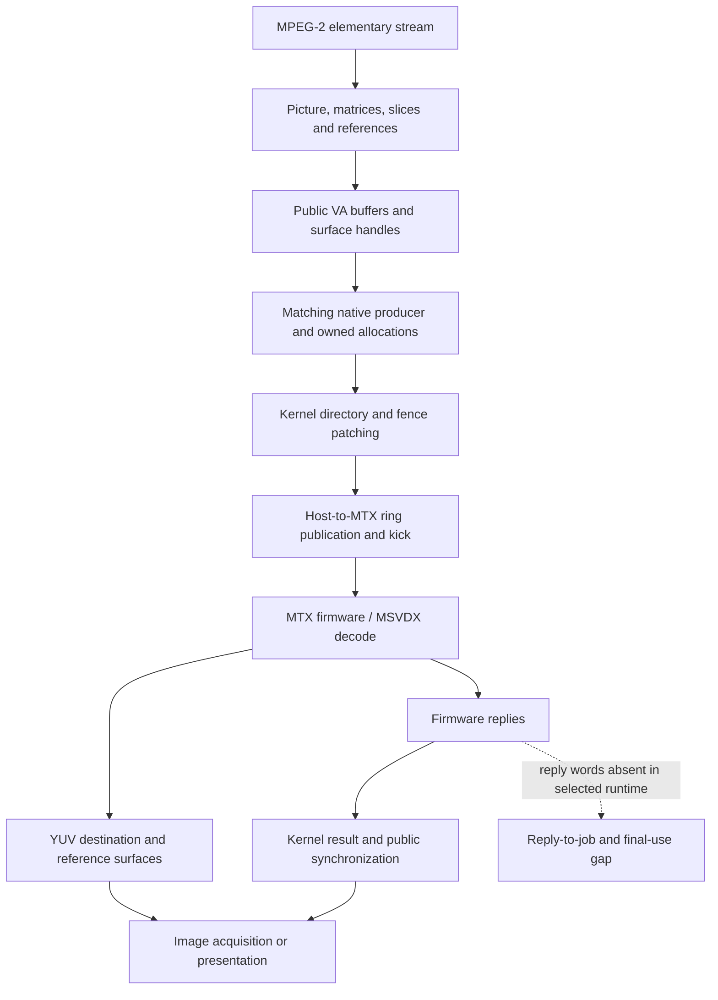

# Video decode: API inputs, native transport and surface lifetime

MSVDX decoding connects compressed-picture inputs, matching host drivers,
native messages and YUV surfaces. Command-address, reply and reference-lifetime
joins remain incomplete in the selected vendor contracts. These mechanisms do
not qualify the current poulsback decoder implementation.

Use Linux EMGD 1.8 Build 2032 as the runtime-matched example and PSB as a separate
ABI/firmware comparison. [Source families](../sources.md) identifies the
components; [MSVDX firmware](msvdx-firmware.md) gives the exact payload formats,
and [publication and surface contracts](surface-layout.md) explains command
patching, NV12 plane bounds and completion limits.

Reading routes: [picture inputs](#a-picture-includes-references-and-structured-input),
[host/loader pairing](#match-the-host-and-loader),
[Windows declarations and host calls](#windows-decode-declarations-and-host-boundary),
[publication and lifetime](#publication-is-separate-from-success-and-last-use),
[coverage](#codec-and-output-coverage) and [surface/performance limits](#layout-and-performance-constraints).

## A picture includes references and structured input

The diagram shows decoder responsibilities. A recovered producer on one edge
does not establish all downstream execution and lifetime contracts.

MPEG-2 submission includes dimensions, coding type, picture flags, quantization
matrices, slice parameters and references to previously decoded surfaces. For
example, coded order **I0, P3, B1, B2** has display order 0, 1, 2, 3. A reference must remain usable after its own
picture's completion; completion of one destination is not its final-use fence.

The EMGD VA picture parameters are 24 bytes, the IQ matrix is 272 bytes and a
public slice descriptor is 32 bytes. The native `RENDER` message is also
32 bytes, but belongs to another ABI. Native command storage additionally
contains register pairs and linked DMA data; its complete owner/relocation graph
has not been recovered.

The selected PSB ABI uses a 28-byte slice descriptor. A 32-byte public
descriptor inserts horizontal position at byte 16; it maps to this ABI only when
that position is zero, by removing that DWORD and keeping macroblock bit offset
and vertical position. Nonzero horizontal positions must be refused. Poulsback
has no such adapter yet: the `mpeg2_va029` helpers reject 32-byte slices
([video](../../video.md)). Arbitrary newer VA buffers cannot be reinterpreted
as this ABI.

## Match the host and loader

| Selected family | Concrete components | Established boundary |
| --- | --- | --- |
| Linux EMGD 1.8 Build 2032; kernel `2.6.38-16-generic`, source `emgd-1.8.0.2032` | Video producer SHA `9176c80f…`; module SHA `551ef206…`; full hashes in the firmware chapter | Seven-u32 packed firmware descriptor, native producer, directory/fence patches and ring transport. |
| Linux PSB; kernel `2.6.32-74-generic`, kernel package 4.42.0, DDX 0.36, firmware 0.30, libva 0.31 | Firmware SHA `61e79920…` | Four-u32 firmware file and its matched loader; separate MPEG-2 input/output observations. |
| Windows EMGD `8.14.1180.3398` | `igdumd32.dll`, 1,719,808 bytes, SHA `7cde4e9b3e29d700b6974951256fb4ff2d6cee1528845321c6c4de038c77c6cd`; `igdkmd32.sys`, 1,745,152 bytes, SHA `9c3486957755a6cdd98b2f30fd70235e78df6910343eca9105f21c1ea506c328` | Identified comparison inputs; no recovered DXVA → native message → reply → YUV chain or selected Windows output capture. |

Retail Windows 2030, XP SDK 2443 and other Linux EMGD variants remain distinct.
Matching filenames or a common message ID do not make their buffers, fence
conventions or payloads interchangeable.

## Windows decode declarations and host boundary

### Vendor decode and encode declarations

Intel's [EMGD 1.16 feature matrix](https://www.intel.com/content/dam/www/public/us/en/documents/drivers/emgd-v1-16-feature-matrix.pdf)
explicitly lists hardware MPEG-2, H.264 AVC, VC-1 and WMV9 decode through DXVA
2.0 on Windows 7/WES7 for US15W/US15WP/US15WPT. Its hardware-encode rows are
marked for E6xx only, not the US15W column. This is a vendor capability statement,
not a measured profile/level, throughput or conformance result for poulsback.
Media SDK encode exports in a multi-device package do not establish a US15W
hardware encoder.

Intel's Windows 7 EMGD v1.18 guide **472133-012**, sections 5.7–5.8 (April 2013),
also distinguishes the player's decode entrypoint. Its table 22 lists:

| Codec | Windows Media Player 12 | PowerDVD 8 build 3204 |
| --- | --- | --- |
| MPEG-2 / H.264 | VLD | VLD |
| VC-1 / WMV9 | MC | VLD |

These are vendor-documented combinations, not our Windows measurements. The
guide associates HD throughput with VLD rather than the legacy MC path and
explicitly excludes US15W hardware encode in section 5.8. The mirrored
[guide transcription](https://manualzilla.com/doc/7305767/bh-fitness-t4---v1-user-guide)
is hosted under an incorrect catalogue title; identify it by document number
and section, not that title. Codec name alone does not specify the amount of
hardware offload, decoded-plane correctness or presentation cost.

### Retail 2030 host submission

The [hardware reference](../../hardware.md#windows-reference-profiles) identifies the
preserved Windows 7 retail and embedded branches separately.
The recovered decoder host chain concerns the paired **retail 2030**
`igdumd32.dll` and `igdkmd32.sys`; it must not be attributed to EMGD 3398.
Original-byte checks establish the following static interfaces:

- `OpenAdapter`/`CreateDevice` install decode and video-processing callbacks.
  A constructed H264VLD object connects Begin/Execute/End to a resource binder
  and `pfnRenderCb`, with a context returned by `CreateContextCb`.
- The selected queue records allocation uses, relocation/patch entries and
  cross-queue sequence dependencies. CPU event handles and context-stream
  synchronization objects have different roles; neither is a decoded surface.
- Queue index 1 reaches a concrete miniport context. Its Render method accepts
  the event/sequence packet, references the event and sets an acknowledgement
  bit. Submit forwards the translated command and event; a DPC path can signal
  and release queued events. Event-reference acceptance is not GPU completion.
- Error handling is significant: the selected EndFrame path can return success
  despite a failed flush, and the effective 10-second wait can software-signal
  an event on timeout. Dependency callbacks can fail before CPU bookkeeping
  advances. None of these outcomes certifies safe GPU-resource reclamation.

This is a recovered host submission chain, not a complete MSVDX wire protocol.
Command/DMA semantics, exact firmware selection and executing MTX bytes, the
authenticated interrupt/reply-to-fence chain, final resource use and decoded
output remain separate contracts. The mapped video queue also cannot qualify
SGX 3D submission or retirement.

These findings support explicit prepared/submitted/completed/retired states,
bounded waits, checked resource/patch lists and transactional error handling in
the Linux implementation. Windows handles, callback tables, WDDM residency and
private packet layouts are not Linux interfaces to copy. Firmware build-marker
strings alone do not establish equal firmware bytes or compatible messages.

### Publisher limits and presentation

The retail 2030 release notes also list known MPEG-2 playback-rate/shaking,
WMV/VC-1 corruption and H.264/DVD stress problems. They are publisher-reported
limits, not reproduced Dell failures. Reports of smooth playback are useful
test leads, but require exact driver, stream, player and output measurements
before becoming a performance baseline. No Windows runtime capture is used as
hardware qualification here.

The separate [EMGD 1.14 Windows specification update](https://www.intel.com/content/dam/www/public/us/en/documents/specification-updates/emgd-v1-14-win7-spec-update.pdf),
issue 203584, describes US15W fullscreen playback lag in PowerDVD 8 when display
uses 3D blending instead of the overlay route. This is a release-specific
publisher report, not a reproduced 3398 defect or a measured Dell clock. It
explains why decode timing and composition/presentation timing must be measured
separately: hardware decode alone does not guarantee smooth playback.

## Publication is separate from success and last use

In matched EMGD source, `populate_fence_id()` assigns a fence to each `RENDER`
message. `process_mtx_messages()` fills its directory word from the selected
SGX physical page-directory register, then calls `send_to_mtx()`. The selected PSB stream helper
repeats one caller-supplied sequence and can request directory invalidation on
the first message. These are different producer policies; a stream formatter
does not own sequence allocation, wrap, epoch or reply matching.

`send_to_mtx()` checks a word-indexed ring, inserts padding when needed, copies
message words, publishes the write index and kicks MTX. Its `words_free - 1`
check reserves a slot to distinguish full from empty. The low header byte's
message length is converted to words; an uncertain nearby source comment does
not establish another unit. The old outer BUSY retry is unbounded and supplies
no suitable timeout policy for a new consumer.

`msvdx_mtx_interrupt_plb()` reads whole replies, advances the host read index
and dispatches by reply ID. **`mtx_completed` can advance for `CMD_COMPLETED`,
`CMD_FAILED` and `CMD_HW_PANIC`.** A changed counter alone cannot certify decode
success. A consumer needs reply kind, sequence/context association, error state
and lifetime rules.

Command buffers, decoded images, reference pictures, mappings and firmware
state need separate last-use boundaries. Legacy VA APIs can consume input
buffers during `vaRenderPicture`; ownership must follow the API/version's
actual rules instead of assuming every input survives until explicit destroy.
A successful cleanup return does not override a device error or establish
hardware retirement.

## Codec and output coverage

EMGD advertises MPEG-2, H.264, MPEG-4 and VC-1 entrypoints, but advertisement,
source support, decoded output and API conformance are separate claims. VLD
and MoComp are different interfaces. A constant MPEG-2 picture can exercise
transport and surface extraction while leaving reference handling, IDCT,
motion compensation, malformed inputs and sustained throughput unqualified.

Nonconstant output requires a criterion selected independently of the observed
image. Related software decoders can produce different reconstructions; their
nearest output is not automatically the normative reference. The codec's
permitted reconstruction error and the exact bitstream, matrices, reference
surfaces and clipping/conversion rules must explain the comparison.

Public slice counts and native entry counts can corroborate an input path but
do not establish a unique slice-to-message-to-reply mapping or decoded/presented
frame count. Buffered end-of-stream input, unsupported candidate pixel formats
and observer overhead must be separated from device failures or dropped frames.

## Layout and performance constraints

Decoded surfaces need independent checks for coded/active dimensions, returned
image geometry, plane offsets/pitches, complete mapped extent and active samples.
Padding and guards are a separate check. A descriptor whose reported size ends
before an active chroma sample cannot be enlarged by guessing from pitch; the
actual owner must establish the readable range.

PSB's selected path uses `CreateImage → GetImage → MapBuffer` rather than
`DeriveImage`. That API route does not prescribe another implementation's
layout. [NV12 plane bounds](surface-layout.md#nv12-plane-bounds) gives the
address formulas and a synthetic example. A constant-color input does not
establish nonconstant reconstruction accuracy or motion/reference handling.
