# EMGD3398 raster policy and viewport Z

The two chains below answer different questions. Allocation flags select a raster convention;
viewport state transforms clip coordinates. Neither chain proves the numerical equation used by
every SGX535 rasterizer or depth-store operation. Scope is **STATIC** for the [matched 3398
kit](../sources.md#windows-emgd-3398).

- [Allocation-selected raster tuple](#allocation-selected-raster-policy)
- [Viewport Z and pretransformed input](#viewport-and-depth)

All code addresses are static PE VAs at image base `0x10000000`. Decimal-looking object offsets
in the prose are explicitly prefixed with `0x`. Register offsets are MMIO **byte offsets**,
while the KMD register template uses DWORD indices. See [address domains](../address-domains.md)
for PE RVA/file mappings. Noncontiguous function bodies and incomplete indirect value-flow
recovery remain limits on the selected analysis.

## Allocation-selected raster policy

The useful starting question is: **who chooses the three single-sample words, and what state
reaches that choice?** The answer is a resource-class policy, not a loose constant found next to
an OpenGL string.

```mermaid
flowchart LR
    O[3398 OpenGL drawable] --> S[SGL screen and type 9 color allocation]
    S --> A[Private allocation descriptor: mask 0x100]
    A --> K[KMD validates and copies descriptor]
    K --> T[Bound target: retained flag mask 0x8]
    T --> R[Single-sample raster template]
    R --> W[MMIO words 0x418 / 0x4c8 / 0x800]
    W -. edge equation remains unknown .-> P[Physical coverage]
```

| Stage | Exact selected producer/consumer | Meaning |
| --- | --- | --- |
| ICD binding | OGL `0x1004c110` resolves `sgl4_create_screen_device` into `0x101df584`; `0x10046d70` calls that slot. | Links the actual matched SGL screen interface, not merely an export name. |
| Screen allocation | SGL `0x10004e88 → 0x10004ae9 → 0x10004b59`; then `0x1001a7ae → 0x1001b144`. | Color allocation request type 9 becomes internal type 3. |
| Private payload | SGL `0x1001efca`; type 3 sets descriptor byte `+0x38` mask `0x04` and byte `+0x39` mask `0x01`. | The DWORD contains `0x104`; the policy-carrying mask is `0x100`. This is not a GPU address. |
| WDDM boundary | SGL `0x1001ef00` and `0x1001cd02` checksum the `0x44` resource and `0x3c` allocation descriptors and call the resolved `D3DKMTCreateAllocation`. | Private wire-format integrity. Checksum success does not prove hardware behavior. |
| KMD copy | `0x10031fa0` validates length/checksum and copies 15 DWORDs. `0x1000c350/0x1000c430` construct vtable `0x1011f048` and retain descriptor DWORD 14 at object `+0x10`. | Binds bytes to a concrete resource class. The flags accessor at vtable `+0x38` is `0x1000cac0`; private data accessor `+0x54` is `0x1000cbd0`. |
| Target setup | Command 4 in `0x100f2220` reads that resource's flags. Mask `0x100` becomes constructor input mask `0x2`; `0x100f7860` sets retained target mask `0x8`. | Dimensions and sample fields are copied separately, not inferred from this bit. |
| Normal rendering | Command `0x80000001` in `0x100f2220` resolves that target through `0x100fac20` and calls `0x100fb4b0`. | Connects the allocation policy to the render consumer. |
| Template | `0x100fb4b0` with template constructor `0x100f8bc0`. | For target DWORD 3 `<2`, flag mask `0x8` selects `(1,0x88,1)`; without it, `(0,0,0)`. MSAA branches are separate. |

The tuple order is `(0x418,0x4c8,0x800)`. Template IDs `0x106`, `0x132`, `0x200` become those
byte offsets only after multiplying by four. The matched source supplies the tuple together. It
does not justify changing one existing register store independently of its resource and sample
prerequisites.

The retained SGX535 rev121 header names `ISP_OGL` at `0x418`, sample nibble fields at `0x4c8`,
and `TSP_CONFIG` at `0x800`. It does **not** name TSP bit 0 as a triangle tie rule. SGX545
sample-position fields and a line-last-pixel control do not establish SGX535 triangle-edge
semantics. The Windows source branch also is not the same thing as Mesa's `half_pixel_center`
and `bottom_edge_rule` pair: drawable orientation and viewport-Y sign still matter.

Error and ownership boundaries matter here. Allocation failure stops the SGL resource path. KMD
validates and copies the private descriptor before its class consumer uses it. The target
constructor can reuse an already matching internal target and increment its reference, or
allocate and initialize a new target; failed initialization releases the new temporary target.
These local branches do not establish later GPU retirement, WDDM residency or a DRM release
policy.

The selected allocation loader and command parser have incomplete indirect value-flow recovery.
The direct assignments and final tuple are established; this does not claim a complete
indirect-call graph.

## Viewport and depth

**What Z value does this OpenGL frontend produce?** For its ordinary default range, the selected
source emits **scale .5, translate .5**. A `1/1` tuple cannot be treated as a
universal OpenGL default.

1. OGL context constructor `0x10047b70` executes `FLD1` and stores F32 one at
   context `+0x1674`; caller `0x10047e50` allocates and initializes the context.
2. `0x10068600` clamps the depth range and produces
   `Sz = (far − near) × context[0x1674] × .5` and
   `Tz = (near + far) × context[0x1674] × .5` at `+0x778/+0x77c`.
   The double `.5` constant is at OGL VA `0x10176a30`; the retained raw slice
   is eight bytes, SHA-256
   `4cfa5b42ca669328764e67cd9a34bb8f90b16ed7ca8d85e8443783d7ccce15ed`.
3. `0x100a1e40` passes six values in order **Sx, Tx, Sy, Ty, Sz, Tz** through
   `0x101df59c`. The loader stores the resolved `sgl4_set_viewport` at this slot;
   the matched symbol is SGL `0x1000e4c3`.
4. SGL stores the six words with internal order **Tx, Sx, Ty, Sy, Tz, Sz**.
   Tz/Sz are at private `+0x21a8/+0x21ac`. Its optional scaling mode changes
   only X/Y. Serializer `0x10006d2e` copies the six viewport words into MTE
   state when the viewport is enabled and dirty, before the later MTE control.
5. The separate OGL CPU clip path `0x10044820` tests clip X/Y/Z against `±W`
   and computes `windowZ = Sz × clipZ/clipW + Tz`.

This closes the selected **source units and host serialization**. It does not recover every
final USE position instruction, hardware W-buffer interaction, ZLS storage format, rounding or
clamp behavior. Static FPU instructions alone do not determine every runtime x87
rounding/control-word condition.

The matched PSB source path provides a useful comparison: `_math_matrix_viewport` multiplies by
`DepthMaxF`, then PSB `0x3be59` divides by the actual framebuffer's `DepthMaxF` when serializing
the viewport. It reaches the same normalized .5/.5 default for a present drawbuffer. The
null-framebuffer path is separate. The matched Linux [DepthRange
chain](depth-state-and-storage.md#linux-depthrange-reaches-the-actual-viewport-vector) follows dispatch
`context+0x3634` into its transformation and viewport-vector stores;
use that chapter for the exact Linux offsets and
scaling conditions. The [coordinate-flow chapter](../emgd-linux/viewport-coordinate-flow.md#two-outputs-of-the-viewport-update)
separately follows viewport dispatch `context+0x3678` and its callback. These chains do not turn
host arithmetic into a hardware quantization rule. The PSB and Windows chains also may share
vendor/SDK ancestry;
agreement is not evidence of independent silicon experiments.

For pretransformed input, SGL's viewport-disabled path sets MTE control mask `0x10000`. That
distinction explains why clip-space and window-space inputs must remain separate. It does not
authorize toggling PRETRANSFORM on an otherwise unrelated task.

## Applying these chains

Keep original clip coordinates, window coordinates and reciprocal W explicit. Bind raster
conventions to the actual resource/sample/orientation policy. Test source serialization
independently from full pixel/depth predictions, then qualify the complete selected physical
packet. These chains do not justify changing the edge oracle after observing an image, assuming
a depth quantizer, qualifying a draw path, or releasing retained GPU owners.

Windows depth clear/load/store, stencil, comparison/write-mask emission and full fragment
compiler linkage remain outside this chapter's closed chains. Use the other family chapters for
already established contracts and keep the unresolved Windows links explicit; a filename or a
matching register constant cannot fill them.
